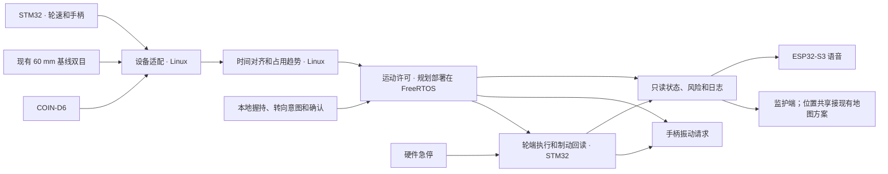

# 随行 V3 辅助出行软件架构与融合说明

机械方案已更新为 [V4 两驱底盘与高位传感器](../cad-v4-two-drive/README.md)。本文的回放以抽象转向和制动请求为输出，涉及四轮执行的描述对应历史 V3 布局。V4 实机接入需核对两路差速、脚轮转向、制动包络和高位感知覆盖。

当前交付为本机可执行的融合、交互仲裁和场景回放。模拟观测输入采用 COIN-D6 与 60 mm 基线双目的抽象模型，双目 SKU 待实物确认。候选型号记录见[早期硬件评估](../../导盲机器人-硬件清单与三板性能评估V1-2026-11-19.md)。

## 当前代码和图片的差异

| 参考图 | 可复用的设计 | 与随行现状的差异及落实 |
|---|---|---|
| 图 1 · 视障人士端 | 距离、方向、场景与提示分开处理 | 图片的目标类别、楼梯级数、斑马线与红绿灯用于参考。现有双目与 D6 输入归一为无类别的占用及运动趋势，回放验证侧向切入。台阶、路口信号及过街授权没有并入本次可运行功能。 |
| 图 2 · 整体系统 | Linux 承担感知，FreeRTOS 承担实时工作，OpenAMP 连接两域 | 随行软件独立实现运动请求时效校验与人工确认。执行回读由后续实机接入提供。 |
| 图 3 · 监护人端 | 用户交互与监护分离，附带位置更新时间和设备状态 | 原有设计含百度地图与轨迹共享。本次落实只读监护状态投影，显示风险、请求状态、原因和观测年龄。原始视频、地图及轨迹服务留在未来的非实时接入侧，按当前输出无法认定车体已停。 |
| 图 4 · 多任务与核间通信 | 慢任务和关键任务分开，核间收发与业务完成分别确认 | 图片按四个外设分配端点。本设计按运动监督与状态诊断划分数据流。运行时原型实现采集时间校验、过期判定和停车锁存，实际 RPMsg 端点、QoS 与轮速回读仍待上板。 |
| 图 5 · 感知、提示、监护 | 同一风险事件派生使用者反馈和监护状态 | 手柄负责方向、警告及紧急振动，ESP32-S3 承接语音。回放同时输出制动请求和反馈类别，监护端接收只读状态。 |

回放保留抽象的转向、减速、制动和保持请求。V4 两路轮端执行及其参数由 M6 在实物台架核对。

## 软件架构和数据方向



| 模块 | 输入与输出 | 依赖边界与扩展 |
|---|---|---|
| 设备适配（实机待接） | 输入 D6 扫描、双目帧和车体运动，输出统一时间、坐标系、观测覆盖、目标占用半径、相对位置与速度 | 负责串口校验、双目同步、标定、姿态补偿与扫描去畸变。协议与设备格式留在适配层，使用真实采样时间，保留拒绝计数。 |
| [数据契约](suixing/contracts.py) | `Observation`、`Obstacle`、`Scene`、`Handle` | 使用米、秒，车前为 +X、车左为 +Y。速度向量表示固定在采样瞬时车体系中的短时相对速度，需要上游进行自车运动补偿。 |
| [融合](suixing/fusion.py) | 接收各设备最新有效观测，输出直行、左转、右转的风险及来源年龄 | 每路只保留最新样本，拒绝未来和倒序数据。通过占用区域与简化人车包络的预计交叠来预警。单源的可信危险可触发升级，清除危险需要两源均有效且报告对应区域覆盖。 |
| [运动许可](suixing/supervisor.py) | 读取融合风险、轮速、方向建议与本地手柄，输出抽象动作和对应振动 | 同向意图、已滚动、握持和安全条件齐全时才允许转向助力。停止锁存后，需要零速、有效观测及本地确认上升沿，启动时按住确认键无效。 |
| 执行与反馈（实机待接） | 消费本地动作，回传制动起效、实际轮速、故障及停车结果 | STM32 独立监测失联和急停。危险振动由底层事件触发，优先于方向振动。ESP32-S3 用于语音。 |
| [场景回放及监护投影](suixing/replay.py) | JSONL 回放输入，输出本地动作和独立的只读监护状态 | 监护数据只含状态、风险、原因和观测年龄。位置上传可从非实时侧扩展，监护端没有运动命令输入。 |

## 接入和融合约定

1. **COIN-D6。** 驱动应提供扫描开始时间、角度、距离、回波有效性和丢帧计数。结合车体运动把扫描转换到统一参考时刻，建立局部占用证据。无回波或自遮挡按不可见处理。V4 CAD 的名义扫描平面约 655 mm。安装高度、遮挡和覆盖范围按装车测量。
2. **现有双目。** 先验证双目同步、内外参和可取得的数据格式，再选设备端深度或软件视差。深度空洞、低匹配质量和画面冻结按覆盖不足处理。摄像头看不到的近车、车侧与使用者后方区域须保留未知状态。
3. **已有轮端和手柄。** 轮速用于相对运动估计、实车制动回读及车体状态检查。轮编码器、IMU 预留位，以及旧文档里的 ToF、UWB、GNSS 候选均需区分实装与设想。只有现有配置和标定能证明的覆盖才允许进入风险判断。手柄应提供经校准的握持、转向意图与确认状态。
4. **时效。** 最终部署记录采样时间、接收时间、启动会话、序号、版本与数据质量。RPMsg 和 STM32 接收侧各自检查有效期，跨核或跨板时间须校准或给出可验证的偏差界。断连后旧包不可复用。回放目前使用同一个单调时钟，并通过时间戳测试新旧数据。
5. **运动边界。** 当前模型接受受控的前向推行和转向场景。横移、倒车、异常打滑或无法确认轮速应置 `motion_supported=false` 或标记执行失效。V4 两路差速执行需测两轮方向、抓地和手柄峰值受力。车体处于未知区域时进入保护，不根据历史轨迹或地图绕开障碍。
6. **性能与通信。** Linux 端采集优先，诊断和监护异步消费。图像及点云留在 Linux。OpenAMP 拟传带有效期的风险摘要与实时监督回执，诊断采用独立队列和明确的丢弃策略。端点数量、处理优先级和传输预算取决于实际 BSP 和压力测试。

回放使用匀速外推和简化矩形包络，以验证数据接口和动作仲裁。真实部署需要车体转弯扫掠、制动距离、目标运动误差、传感器盲区及最坏延迟的实测证据，测试配置中的数字仅用于合成样例。制动请求、STM32 收到命令、制动实际起效和车轮停稳应单独记录。

## 运行与验收

在本目录使用 Python 3.10 或更高版本：

```powershell
python -B -m unittest discover -v
python -B -m suixing.replay examples/crossing.jsonl
```

回放按“启动保持、确认后推行、同向转向助力、横切制动与紧急振动、停车后保持、重新确认”输出记录。样例中两源的覆盖是合成输入，不能直接据此设定真实双目或 D6 的覆盖区域。

## 仍需确认

| 待确认项 | 需要的证据 | 影响 |
|---|---|---|
| 双目 SKU、实际视频格式与同步能力 | 实物铭牌、飞腾 ARM64 RGB/双帧取流、时间戳与标定数据 | 决定深度输入与短时目标估计 |
| D6 驱动、串口和扫描时序 | 型号对应文档、ARM64 稳定取流与装车遮挡测试 | 决定扫描去畸变和盲区判断 |
| 已实装的轮速、手柄与其他传感器 | 台架清点、引脚表、校准和故障状态读数 | 确定可用信号与核心链路的覆盖范围 |
| V4 两路差速与制动 | 两路驱动方向、脚轮扫掠、失能后的滑行、可用最小减速度、手柄峰值力 | 决定助力方向、制动策略和场景速度 |
| 实时部署及交互 | OpenAMP 业务往返、STM32 失联停车、两侧振动辨识、执行回读 | 完成从软件请求到实机行为的闭环 |
| 监护业务 | 授权机制、位置来源、延迟、离线状态与用户同意 | 将只读状态接入现有百度地图和轨迹方案 |
