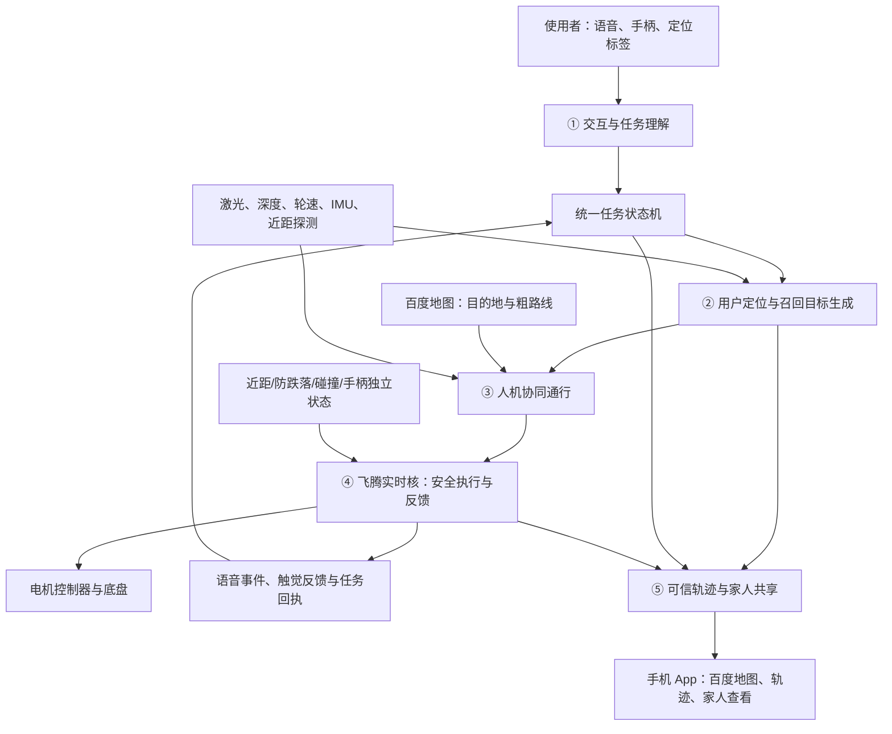

# 人机协同导盲机器人：业务模块化顶层设计 V2

> 历史选型资料。当前分工、交付状态和验收范围见[开发与验收基线](开发与验收基线.md)。

日期：2026-11-19\
定位：研究生团队面向集创赛、研电赛的可审阅设计方案。\
状态：已完成公开资料与开源选型核对；板端部署、性能、风险控制和 FIT 均尚未在本轮执行。本文的技术贡献为拟验证方案，不表示已证明原创性或已获得安全认证。

## 1. 设计目标与业务主线

系统服务于一个完整需求：使用者呼叫后，机器人找到正确的人并安全接近；使用者握住手柄后，机器人结合目的地路线和现场环境辅助通行；过程中持续提供语音、触觉反馈，并向获授权的家人共享可信的位置与状态。

保留的主要功能：
1. 实时位置与运动轨迹更新、历史轨迹查询。
2. 百度地图路线查询、地图展示，以及需要时调起百度地图 App。
3. 手机 App 与家人共享位置。
4. 语音交互与运动任务控制，包括“小车过来”“停下”等。
5. 自主避障，遇到障碍时触发语音播报。
6. 原概念中的力感手柄、触觉反馈与急停。

设计以已建图、平整、低速、有人监护的园区或室内连通区域为首批验证场景。召回与导行共用导航执行链；导行时机器人位于使用者前方，通过手柄提供辅助。位置共享并行观察任务进展。

业务流程：
准备与绑定 → 语音呼叫 → 确认用户与停靠目标 → 安全接近 → 停车提示 → 握柄确认 → 协同导行 → 障碍绕行或停车并反馈 → 任务结束。

状态机：
待机、寻找用户、召回接近、等待握柄、协同导行、受阻停车、故障停车。
恢复条件由感知与实时监督共同确认；故障恢复后需重新确认运动任务。全局“停下”和硬件急停可以中断任意运动状态。

## 2. 顶层架构

按业务决策划分为五个模块，每个模块有一项主要的先进技术方法。定位、用户身份、风险与任务状态在模块间复用，避免重复推理和重复维护状态。

关键边界：
- 任务层输出有期限的结构化任务；运动模块输出速度建议与有效性说明。
- 模块②生成“靠近谁、停在哪里”，模块③统一求解“怎样到达”。
- 模块③同时考虑机器人、手柄与使用者的扫掠空间。
- 模块④在飞腾 CPU 的独立实时域检查运动建议、数据新鲜度和故障状态。
- 模块⑤使用已有定位、状态及事件结果；断网时本地安全链路继续运行。
- 家人共享采用只读业务入口；远端数据不直接进入底盘速度接口。

## 3. GitHub 选型与融合边界

以下 Stars 为 2026-11-19 通过 GitHub 插件读取 GitHub API 得到的快照。完整原始选型字段见同目录 JSON。Stars 用于筛选社区关注度，适配判断还依据 CPU 部署路径、接口和依赖。没有对这些仓库做完整代码审计或板上复现。

| 项目 | Stars | 本方案用途 | 适配与复用边界 |
|---|---:|---|---|
| [Tencent/ncnn](https://github.com/Tencent/ncnn) | 24,062 | 飞腾 Linux 上的轻量视觉推理 | ARM64 CPU 后端；模型在开发机训练、转换和校准 |
| [k2-fsa/sherpa-onnx](https://github.com/k2-fsa/sherpa-onnx) | 16,028 | 离线语音识别、VAD、语音合成 | 选中文小型流式模型；按所选模型验证 INT8、词表和实时率 |
| [Megvii-BaseDetection/YOLOX](https://github.com/Megvii-BaseDetection/YOLOX) | 10,714 | 轻量人员与动态障碍检测基线 | Nano/Tiny 候选，复用官方 ncnn 部署路径；训练环境与板端运行环境分开 |
| [traccar/traccar](https://github.com/traccar/traccar) | 8,151 | 家人共享、轨迹存储与权限服务底座 | Java 服务部署于服务器；手机 App 自行集成百度地图与业务页面 |
| [FoundationVision/ByteTrack](https://github.com/FoundationVision/ByteTrack) | 6,821 | 连续人员跟踪 | 复用跟踪与 ncnn/C++ 部署接口；绑定用户身份和 UWB 融合由本项目实现 |
| [ros-navigation/navigation2](https://github.com/ros-navigation/navigation2) | 5,078 | 统一导航执行、行为树、MPPI 与碰撞监测 | 选择与固定 ROS 2 发行版对应的分支；扩展人机联合风险评价 |
| [SteveMacenski/slam_toolbox](https://github.com/SteveMacenski/slam_toolbox) | 2,722 | 已建图区域的激光建图与定位 | 先完成地图，再以定位模式运行；控制图规模和缓存 |
| [cra-ros-pkg/robot_localization](https://github.com/cra-ros-pkg/robot_localization) | 1,991 | 轮速、IMU、GNSS 等定位信息融合 | 按传感器实际可观测量配置滤波；相对定位与全球定位分别维护 |
| [OpenAMP/open-amp](https://github.com/OpenAMP/open-amp) | 929 | 理解 RPMsg、Remoteproc 等机制 | 板端工程以飞腾官方适配 SDK 为依据 |

芯片适配必须复用 [飞腾官方 Phytium-FreeRTOS-SDK](https://gitee.com/phytium_embedded/phytium-free-rtos-sdk) 及其所依赖的 Standalone SDK、匹配的 Linux BSP。官方 SDK 区分开发分支与发布分支；最终固定经过目标板复核的发布组合和提交版本。[官方说明](https://gitee.com/phytium_embedded/phytium-free-rtos-sdk)

本轮还筛查了：
- [siemens/jailhouse](https://github.com/siemens/jailhouse)：1,979 Stars，作为分区方案参考。本版中阶主线选择 OpenAMP，保证多核通信、实时监控与业务路径相互对应。
- [PhytiumFlyers](https://github.com/Lawrence-Leung/PhytiumFlyers)：7 Stars；[2DSLAMCar-BasedOn-Phytiumpi](https://github.com/wang-ruifan/2DSLAMCar-BasedOn-Phytiumpi)：6 Stars。两者仅作为飞腾多核通信与移动平台接入参考；其板卡、镜像与当前 V3 的匹配需要另验。仓库中的获奖陈述属于作者自述，本方案不以此证明兼容性或奖级。

YOLOX、ByteTrack 和二维 SLAM 是成熟基线。拟研究贡献集中于下面的跨模态关联、联合通行风险和运行时保障；是否具有足够的新颖性，需要后续文献、产品检索和对比实验共同确认。

## 4. 五个业务模块

### 模块①：交互与任务理解——听懂使用者要做什么

业务输入：麦克风语音、App 绑定身份、当前任务状态、手柄握持与受力事件。\
业务输出：结构化任务，包括召回、停止、继续、设定已支持的目的地；同时输出识别质量、确认状态和有效期限。

主技术：端侧流式语音模型与置信度驱动的任务执行。

复用 sherpa-onnx 的 VAD、中文流式识别及 TTS；唤醒或按键触发后再启用完整识别。固定高频播报可以缓存音频。该项目官方支持 ARM64 Linux、流式及非流式语音处理。[项目说明](https://github.com/k2-fsa/sherpa-onnx)

自主优化：
1. 将语音分数、用户绑定状态和当前业务状态联合用于执行判断。
2. 同一句“过来”在待机状态生成召回请求，在已握柄状态进行简短澄清或状态提示。
3. 低质量或互相矛盾的输入触发确认；“停下”具有高优先级。
4. 任务携带用户、任务编号、时效和取消语义；连续重复呼叫不会积累成多个运动任务。
5. 语音识别分数需通过测试集校准；说话人验证可作为辅助信息，身份仍由绑定与目标关联共同确认。

价值：减少误触发、重复执行和模糊指令引起的运动；前沿语音模型直接服务于任务闭环。

### 模块②：用户定位与召回目标生成——找到正确的人并确定停靠位置

业务输入：召回任务、RGB-D 图像、人员跟踪、绑定的 UWB 标签信息、机器人位姿。\
业务输出：绑定用户的相对位置、朝向估计、协方差/质量说明、目标停靠姿态与失效原因。

主技术：不确定性感知的视觉—UWB 融合与目标关联。

复用 YOLOX + ByteTrack + ncnn。共享同一条检测流水线，人员检测同时为召回和动态避障提供输入。新增的 UWB 标签是实现准确召回的必要定位手段之一；车端采用具有测向能力的方案，或有足够测距几何的多点方案。单路测距只能提供距离约束。

自主优化：
1. 通过标签身份确定目标用户，再利用 UWB 几何信息、相机深度和视觉轨迹进行候选关联。
2. 根据遮挡、信号异常与观测一致性调整融合权重；多个候选无法唯一关联时停止接近并请求确认。
3. 遮挡后重捕获需重新通过关联门限；ByteTrack 的数字 ID 本身不代表真实用户身份。
4. 根据使用者位置、朝向、手柄位置与可达空间计算停靠区域。人体朝向不确定时，先在可验证的安全距离停车并提示对齐。
5. 将定位质量与数据年龄传给通行和共享模块，避免下游把低质量坐标当成精确位置。

“过来”表示前往用户附近的可握柄停靠区域。最终接近不能直接使用普通手机地图坐标。召回路径仍由模块③计算。

### 模块③：人机协同通行——车与人共同安全通过

业务输入：召回停靠目标或导行目的地、机器人与用户位姿、激光/深度障碍、手柄受力、百度地图粗路线。\
业务输出：带时间戳的速度建议、路径可行性、危险事件与可解释的停车原因。

主技术：考虑人机联合扫掠空间的风险预测控制。

复用 Nav2 的行为树、规划与 MPPI 框架；由 slam_toolbox 和 robot_localization 提供经配置验证的定位输入。Nav2 MPPI 本身是可配置的预测控制器，其计算量与采样数量、预测步数及地图设置有关；本板配置需要实测。[官方 MPPI 文档](https://docs.nav2.org/rolling/configuration_and_development/configuration_guide/controller_plugins/mppi_controller/configuring_mppic/)

自主优化：
1. 建立机器人、手柄和使用者身体的联合通行包络，预测人在机器人转弯后的滞后轨迹。
2. 在 MPPI 评价中加入人体碰撞风险、手柄偏转/牵引变化、窄路通行和停靠对齐代价。
3. 深度几何、近距与向下探测负责补充台阶、坑洞和高处障碍信息。无有效观测的区域保留为未知或禁行区域。
4. 以速度、观测年龄、定位不确定性、实测制动能力动态扩展安全距离。
5. 地图粗路线转换为本地可验证的途经区域；现场环境决定是否绕行或停车。
6. Nav2 Collision Monitor 提供主核近距保护；独立实时核继续检查新鲜度与底层限速条件。[Collision Monitor 文档](https://docs.nav2.org/rolling/configuration_and_development/configuration_guide/core_servers/collision_monitor/configuring_collision_monitor_node/)

力感手柄用于共享控制：使用者停步、后拉或明显偏离时，调整运动许可与速度；参数通过受力、舒适性和误触发实验标定。

模型计算失败、规划超时或安全区域内没有可行路径时进入停车状态。动作与播报并行触发，制动链路不等待 TTS。

### 模块④：安全执行与反馈——让运动建议在有效条件下执行

业务输入：Linux 的速度建议与感知有效性、CPU3 可直接读取的近距/防跌落/碰撞/手柄状态、执行器反馈。\
业务输出：最终允许的运动、故障状态、反馈事件及可追溯日志。

主技术：基于飞腾 AMP 的混合关键性执行与运行时保障。

飞腾 Linux 运行感知与规划；按匹配 BSP 将一个核心交给 FreeRTOS。CPU3 接收 RPMsg 小消息，承担：
- 指令范围、顺序、会话、校验和与新鲜度检查；
- 速度和加速度许可、近距风险检查、主核心跳监控；
- 感知失效时的降级/停车状态机；
- 对执行器回读的检查；
- 可独立产生的振动、蜂鸣等故障提示，以及向主核发送语音事件。

中阶证据需包括真实业务指令和反馈的核间往返、任务调度、资源配置与负载对照。回显例程仅用于通信门禁。

RPMsg 使用控制与遥测端点、有界队列、流控与明确的溢出处理。图片、音频和点云留在 Linux 域；端点分开本身不能证明带宽或时限隔离。

OpenAMP 提供通信与部署机制。内存保留区、共享内存缓存一致性、设备树、IRQ、外设归属与驱动需要单独核对。本版的保证范围是经过验证的功能故障处置；Linux 与实时核仍共享 SoC、DDR、供电等资源。

STM32 或独立驱动器承担电机闭环和飞腾整板失联后的失联制动兜底。与飞腾芯片相关的主要风险分析、监督策略和验证保留在飞腾实时域，形成高阶任务的主体证据。

### 模块⑤：可信轨迹与家人共享——让家人看到位置的真实状态

业务输入：机器人位置、使用者手机位置（获得授权时）、定位质量、任务状态与安全事件。\
业务输出：App 地图、实时轨迹、历史轨迹、最后更新时间、离线状态和获授权的家人查看入口。

主技术：带位置误差与时间界的事件触发同步、端云协同的轨迹质量表达。

复用 Traccar 的轨迹、设备、权限与事件底座；手机 App 集成百度地图 SDK。Traccar 提供 REST 与实时 WebSocket 接口；官方文档说明 WebSocket 使用会话 Cookie 授权。[API 文档](https://www.traccar.org/traccar-api/)

自主优化：
1. 使用模块②/③已有的定位质量与模块④已有的安全事件，不另建一条感知链。
2. 位置变化超过允许误差、状态改变或达到最大发布间隔时上传；通过历史数据测量轨迹误差与流量的关系。
3. 显示“更新于何时”“定位是否稳定”；断网后补传历史点，旧点不会被当成当前位置重新播放。
4. 分别维护机器人与使用者两个位置实体。机器人被召回期间，两者可以不在一起。
5. 室内没有可靠的全球定位关联时，展示室内/定位受限状态及最近可靠位置，不凭本地 SLAM 坐标制造全球经纬度。
6. 在服务器端通过受限网关实现邀请、撤销和只读共享；设备写入凭据与家人读取权限分离。

坐标规则：
- 轨迹存储和传感器全局融合采用明确标记的原始全球坐标类型；本地运动采用米制坐标与 frame_id。
- 手机百度地图展示和路线请求按接口要求转换坐标。百度路线接口允许声明输入坐标类型，返回坐标也有规定。[百度步行接口](https://lbsyun.baidu.com/docs/webapi?title=directionlite/guide/webservice-lwrouteplanapi/walk)
- 显示纠偏或道路吸附产生的轨迹与原始定位保留来源区别。
- 主方案由 Traccar 管理历史轨迹，百度承担地图与路线。需要调起百度地图 App 时使用官方 URI 接口。[百度 URI](https://api.map.baidu.com/lbsapi/uri.htm)

## 5. 统一的数据与控制契约

统一状态对象包括：
- Task：task_id、user_id、任务类型、目的地、状态、取消标记。
- UserEstimate：相对位置/朝向、观测来源、误差/质量、时间、关联状态。
- RobotEstimate：本地位姿、全球关联、协方差、时间、地图版本。
- MotionProposal：会话与序号、期望 v/ω、产生时间、有效期限、感知有效性摘要。
- SafetyState：运行许可、故障位、停车原因、执行器回读、发生时间。
- TelemetryEvent：实体身份、位置来源、采集时间、接收时间、状态与事件。

Linux、FreeRTOS 与手机的时间语义必须明确。监督用单调时钟；跨域时间通过已验证的同步或偏差界处理。仅检查“刚收到消息”不足以证明观测新鲜。

运动状态只接受当前任务和当前启动会话下的有效命令。取消任务、紧急停车或启动会话变化后，旧队列中的运动建议全部失效。反馈事件按严重程度调度并去重：
- 正常进展：简短提示。
- 一般障碍：根据环境减速或绕行，必要时提示。
- 受阻：停车并播报“前方受阻，已停车”。
- 紧急/故障：立即执行停车策略，同时触觉/蜂鸣提示；语音通道可用时播报原因。

## 6. 飞腾派 V3 的部署与资源预算

本地基线参考：
- [当前板端与工具环境](开发环境与安装.md#ubuntuhumble-与飞腾工具链)
- [开源项目适配筛查报告](飞腾派V3-开源项目适配筛查报告-2026-11-16.md)

这些资料以 CEK8903、四核 E2000、4GB、无板载 NPU 为配置基线，涉及 Debian 12 / 厂商内核。不同文档对 OpenAMP 的完成状态存在不同口径；本轮将其列为需要实机复核的前置项。

| 部署域 | 责任 | 资源原则 |
|---|---|---|
| 飞腾 Linux：两个大核与一个小核，实际编号按拓扑确认 | 语音、轻量视觉、定位、导航、App 通信 | 线程池限额、队列有界、按任务调频；为定位和控制桥接保留调度预算 |
| 飞腾 CPU3 / 对应保留核：FreeRTOS | 运行时监督、限速、近距检查、心跳与回读 | 独占声明的外设、中断及内存区域；监督周期可从 100Hz 的调试目标开始测量 |
| STM32 / 电机控制器 | 电机闭环、整板失联制动 | 接收受控速度与心跳；其制动行为在实际底盘上验证 |
| 服务器 | Traccar、轨迹与权限 | 远端部署，避免占用板端实时计算资源 |
| 开发电脑 | 训练、量化、回放、可视化与仿真 | 产物导出到板端；现场运行时远程可视化 |

软件适配基线：
1. 保留或建立经验证的飞腾 BSP、设备树与 OpenAMP 启动链，先核对实际内核版本。
2. ROS 2 统一选 Jazzy 系列。优先以 ARM64 Ubuntu 24.04 用户态容器承载对应二进制包，宿主负责板级驱动和 RTOS；确认宿主内核特性、设备透传和 DDS 网络可用后冻结镜像。容器共享宿主内核，不能代替 BSP 适配。
3. 所有 ROS 包固定到该发行版兼容版本；GitHub 表中的默认分支仅表示查询时的仓库状态。
4. YOLOX 与 ByteTrack 采用轻量 C++/ncnn 部署，运行时裁去训练依赖。
5. sherpa-onnx 复用其 ONNX Runtime 部署路径；模型逐个测量内存和实时率。
6. 开始时采用小范围地图、有限 MPPI 采样和按需语音处理。参考调试目标为视觉 5–10Hz、导航控制约 10Hz；它们不是板端实测结果或验收承诺。
7. 根据业务状态复用检测结果、降低非关键处理频率。导航/感知无法满足有效期时停车，资源优化不得放宽停车条件。
8. 日志异步写入并限制大小；CPU3 记录固定大小事件环，故障前后导出。生产运行不在板上开启 RViz。

[ROS 平台支持依据：REP-2000](https://github.com/ros-infrastructure/rep/blob/master/rep-2000.rst)

关键硬件接入：
- USB RGB-D、二维激光、外接 IMU、轮速编码器。
- 可形成有效相对定位的 UWB 车端与佩戴标签。
- 力感/握持输入、触觉执行器、急停、碰撞与向下探测。
- 实时核可直接读取必要的独立近距状态。
- 电机控制器与通信收发器按实际电平、CAN/CAN-FD 类型匹配；最终接线以 V3 规格和器件数据手册为准。
- 一个硬件外设只由明确的驱动域拥有；跨域共享通过消息或经验证的代理实现。

## 7. 基础、中阶、高阶任务的对应关系

| 赛题要求 | 本方案对应设计 | 需要提交的证据 |
|---|---|---|
| 基于飞腾构建完整电子系统 | 感知、导航、监督与底盘组成完整任务链 | 实物、硬件连接、软件部署、完整业务演示 |
| 至少一项前沿技术或复杂处理 | 端侧语音、视觉识别、跨模态定位与预测通行 | 板端模型、数据、推理测量与任务效果 |
| 深度应用飞腾开源项目 | 官方 SDK + OpenAMP + FreeRTOS，承载运动监督与回执 | 固定版本、配置、启动记录、真实业务通信和负载实验 |
| 利用多核算力 | Linux 感知规划与实时核监督并行 | 核分配、调度跟踪、CPU/RSS、时限分布 |
| 功能规范与测试对应 | 第8节功能覆盖表 | 需求—用例—日志—结果矩阵 |
| 芯片应用相关风险分析 | 第9节风险表 | 原因、后果、检测、管控、残余风险 |
| 风险管控与 FIT | 第9节 FI-01 至 FI-12 | 注入点、触发时间、保护行为与物理测量 |
| 复杂环境验证 | 第10节实验设计 | 受控环境与实机场景记录、重复次数、失败案例 |

说明：这里只对齐用户提供的赛题文字，不推定各部分分值，也不据此承诺奖级。

## 8. 功能规范与测试覆盖分析

本表建立测试计划与全部已列功能的对应关系。每组用例展开时记录前置状态、输入、正常/边界/异常步骤、预期输出、测量方法、版本、执行结果和证据路径。

| 需求 | 功能规范 | 对应测试组与主要场景 | 验收观察 |
|---|---|---|---|
| F01 | 支持语音召回、停止、继续及已支持目的地 | TC-F01：正常语音、噪声、重复命令、低质量输入、运动中停止 | 正确任务、误触发、取消优先级、响应时延 |
| F02 | 识别绑定用户并产生有效停靠目标 | TC-F02：多人、遮挡重捕获、相似距离、UWB 异常、朝向未知 | 关联结果、误关联、目标质量和失效处置 |
| F03 | 从当前位置安全召回至可握柄区域 | TC-F03：不同距离/朝向、有障碍、无可行路径、用户移动 | 到达率、停车姿态误差、人体最小间距、失败原因 |
| F04 | 握柄后切换为协同导行并响应受力 | TC-F04：握柄/松柄、后拉、停步、转弯和偏离 | 状态切换、受力与加减速响应、误切换 |
| F05 | 规划覆盖人机共同通行空间并自主避障 | TC-F05：窄路、侧方障碍、动态行人、上方障碍、台阶/坑洞、未知区域 | 人体/车体间距、漏检、保守停车和通行率 |
| F06 | 障碍与故障触发语音及触觉反馈 | TC-F06：一般障碍、完全受阻、重复事件、语音通道失效 | 动作与反馈的时间关系、优先级、去重、独立提示 |
| F07 | 接入百度地图并保持正确坐标语义 | TC-F07：目的地检索、粗路线、本地途经点、坐标转换、接口异常 | 地图一致性、路线可达检查、异常降级 |
| F08 | 更新实时轨迹并支持历史查询 | TC-F08：正常上传、时间错序、漂移、离线补传、室内定位受限 | 最新点时效、历史顺序、误差与来源标记 |
| F09 | 支持获授权的家人查看位置 | TC-F09：邀请、撤销、未授权访问、人车分离、离线与旧位置 | 查看权限、实体区分、最后更新时间和撤销效果 |
| F10 | 支持急停、受阻/故障停车与受控恢复 | TC-F10：各运动状态急停、故障恢复、重启、旧任务残留 | 停车行为、旧命令失效、恢复条件 |
| F11 | 完成飞腾多核通信与运行时监督 | TC-F11：正常核间往返、负载、队列边界、序号/校验/有效期错误 | 回执、时限、拒绝原因和实时核响应 |
| F12 | 保留可追溯事件与 FIT 证据 | TC-F12：故障前后记录、日志限额、掉网、版本回放、日志提取 | 证据完整性、时间关联与记录对控制的影响 |

覆盖口径：
- 计划可追溯覆盖率 = 已分配测试组的功能数 / 功能规范总数。当前为 12/12。
- 执行覆盖率 = 已完成有效测试的功能数 / 12；本轮未做实机执行，不报告为 100%。
- 通过率 = 达到验收条件的已执行用例 / 已执行用例，和覆盖率分别报告。
- 任一模块新增功能、状态或对外接口，都必须补充需求及用例再更新覆盖表。
- 代码覆盖、分支覆盖和物理场景覆盖属于补充指标，不能替代功能规范覆盖。

## 9. 芯片相关风险、管控与故障注入 FIT

先确定危险：错误接近用户、突然牵引、越过可停车边界、故障后持续运动、错误共享位置。再沿飞腾平台上的处理、通信、时钟、内存、外设和执行链分析。

| 风险 | 可能原因及后果 | 基于飞腾的管控策略 | FIT 注入与验证 |
|---|---|---|---|
| R01 | Linux CPU 饱和或规划阻塞，旧运动建议持续生效 | 线程/核预算、有界队列；CPU3 检查建议有效期并停车 | FI-01：压力负载、暂停规划；测量建议年龄与停车时延 |
| R02 | 模型/导航内存异常或进程退出，状态失联 | 内存配额、关键状态心跳；CPU3 使运动许可失效 | FI-02：受控内存压力、终止非实时进程；验证监督不依赖该进程存活 |
| R03 | RPMsg 重复、乱序、丢包或随机内容损坏 | 启动会话、序号、长度、校验与范围检查；错误不刷新有效性 | FI-03：在应用协议测试层注入错误序列与比特变化，检查拒绝与日志 |
| R04 | 控制桥接失联或积压，收到过期建议 | 队列限长、丢弃旧建议、源时间检查和单调时钟监督 | FI-04：停止发送、延迟转发、回放旧会话，验证停车与旧指令拒绝 |
| R05 | CPU3 监督任务卡死，飞腾安全域失效 | 周期与看门狗监控；独立执行器按飞腾心跳失联制动 | FI-05：在测试固件中暂停监督；测量执行器失联行为，禁止未确认自动恢复 |
| R06 | 共享缓冲区越界、缓存同步错误，数据失真 | 定长结构、边界与版本检查、保留区配置、缓存一致性审查 | FI-06：测试缓冲内容损坏及边界输入，验证发现并拒绝异常；并核对实际 cache 配置 |
| R07 | Linux 与 RTOS 重复占用外设/IRQ，采集或制动异常 | 设备树与资源清单明确所有权；启动前检查关键外设回读和健康 | FI-07：电机断使能时加载受控错误资源配置，验证禁止进入可运动状态 |
| R08 | 墙钟跳变、跨核时钟偏差或重启，过期消息被接受 | 监督用单调时钟；偏差界、启动会话和有效期统一 | FI-08：注入时间跳变与会话重启，测量时效判断和重新握手 |
| R09 | 视觉 ID 切换、位置跳变或 UWB 异常，接近错误的人 | 跨模态一致性门控、低质量禁行、CPU3 检查状态有效位与速度限制 | FI-09：注入错误 ID/突变位姿并配合多人场景，验证关联失效和停止接近 |
| R10 | 相机、激光、近距数据冻结或失效，遗漏危险 | 分源新鲜度监控、必要独立近距输入；关键数据无效时 CPU3 降级/停车 | FI-10：冻结帧、拔除受测传感器、遮挡，验证各状态下的保护路径 |
| R11 | 网络断连、服务端阻塞或日志存储耗尽，干扰本地运行 | 网络与日志低优先级、有限缓存；本地运动监督独立 | FI-11：阻断服务器、限制日志分区配额；验证本地时限与位置过期标记 |
| R12 | 过热、欠压、SoC 重启/整板失效，所有飞腾核心受影响 | 可用平台健康监测与受控退出；独立执行器失联制动、重启禁行 | FI-12：受控平台重启/供电故障试验，记录制动与重新启动条件 |

FIT 边界与记录要求：
- 初期使用仿真、台架、架空轮或假人；再逐步进入有监护的低速场景。
- 每个 FI 记录注入位置、故障持续时间、覆盖的风险、检测延迟、管控动作、执行器实测响应、结果及残余风险。
- 应用消息损坏测试检验的是协议与软件防护；共享内存测试也需额外核对实际内存、缓存与驱动行为。
- 视觉—UWB 的一致性检查不能覆盖所有相关失效；多人误关联与共同观测错误应保留失败样本。
- CPU3 无法独立覆盖整颗 SoC 的共同原因故障，R12 需要外部兜底证据。
- 保护路径按最终底盘的服务制动、失联行为及坡面风险验证；驱动使能变化需与实际停车效果对应。

验收时限采用可测的预算：
T_react = 数据有效期/失联判定上界 + 监督最坏响应 + 通信/驱动最坏延迟。

所需探测与停车距离采用：
d_required = v × T_react + v² / (2 × a_min) + d_margin。

其中 a_min 来自实际底盘、负载和地面的制动测量；d_margin 覆盖定位、距离误差及人机滞后。安全速度、数据有效期和监测区域由这些结果共同约束。每条故障路径分别验证，不用平均时延替代最坏路径测量。

## 10. 自主贡献与实验设计

### 10.1 各模块可验证的优化贡献

| 模块 | 拟验证贡献 | 基线 | 核心指标 |
|---|---|---|---|
| ① 交互 | 结合任务状态和置信度的命令执行 | 识别到关键词即执行 | 误触发率、重复执行、停止响应、任务成功率 |
| ② 召回目标 | 不确定性感知的视觉—UWB 关联与停靠生成 | 视觉跟踪、UWB 单源、固定权重融合 | 错误用户接近、目标丢失、重捕获时间、停靠误差 |
| ③ 协同通行 | 人机联合包络与风险预测评价 | 仅考虑车体的同一导航底座 | 人体最小间距、碰撞/接触、牵引变化、通行率与耗时 |
| ④ 安全执行 | 飞腾多核上的时效契约和故障闭环 | Linux 单域监督、AMP 无完整契约、本版 AMP 监督 | 时限违约、故障检测/停车时间、误停车和控制稳定性 |
| ⑤ 家人共享 | 带误差界和状态事件的轨迹同步 | 固定频率位置上传 | 同等轨迹误差下的上传量、位置年龄、旧点识别、断网恢复 |

这些是待研究和验证的贡献假设。实验结果决定论文、答辩与项目说明中的最终贡献表述。

### 10.2 对照与消融

同一底盘、同一速度上限、传感器、路线与障碍布置下进行配对对照：
- A：成熟开源底座。
- B：底座加拟验证模块。
- C：完整链路。

逐项移除 UWB 质量门控、人体包络、实时核时效检查和事件触发同步，观察对应指标变化。各模块消融分别进行，避免多项改动同时发生而无法归因。

报告包含路线、重复次数、环境与人群条件、误差分布、极端值和失败事件；召回结果同时报告成功数/总次数与误关联数。提前固定指标与失败定义。

### 10.3 分阶段门禁

| 门禁 | 工作内容 | 通过证据 |
|---|---|---|
| G0 平台 | 识别 V3 实际镜像、核拓扑、BSP/SDK/设备树；核间握手与安全回读 | 版本清单、启动日志、外设所有权和通信记录 |
| G1 本地闭环 | 执行器闭环、急停、CPU3 指令契约、近距与失联停车 | TC-F10、TC-F11 及 FI-03、FI-04、FI-05 的台架记录 |
| G2 召回 | 语音、目标关联、停靠区与统一导航 | TC-F01/F02/F03 与对应消融数据 |
| G3 导行 | 握柄状态、联合包络、障碍和反馈 | TC-F04/F05/F06，假人和受控场景数据 |
| G4 联网 | 百度地图、Traccar、手机 App 与共享 | TC-F07/F08/F09，坐标/权限/离线记录 |
| G5 高阶证据 | 完整风险管控、全部 FIT、场景回归 | 需求覆盖矩阵、风险关闭情况、结果与残余风险 |

本版保留全部主要功能，按安全闭环、召回、导行、联网的依赖顺序逐步集成。

## 11. 交付物与答辩主线

交付物：
1. 功能规范与业务状态机。
2. 硬件连接、外设所有权、核与内存部署图。
3. 固定版本的软件清单、模型来源、许可及修改记录。
4. 模块接口与异常处理说明。
5. 需求—风险—管控—测试—证据追溯矩阵。
6. 板端性能数据、对比/消融结果、完整失败记录。
7. FIT 注入与验证报告。
8. 连贯业务演示：呼叫 → 找到绑定用户 → 避障接近 → 可握柄停车 → 握柄导行 → 受阻停车并播报 → 家人 App 查看位置与更新时间。
9. 高阶演示：运动中终止 Linux 规划或中断核间业务消息，展示 CPU3 拒绝过期指令及经过验证的停车结果。

建议项目名称：
“随行”：基于飞腾多核协同的可信召回与安全导盲系统。

答辩围绕一个问题展开：当用户目标、环境与计算状态不断变化时，系统如何持续判断“现在是否有条件继续运动”，并让使用者和家人理解当前状态。五个模块提供这条判断链所需的信息、决策、执行与证据。

## 12. 本轮核对范围

本轮已完成：
- 读取 GitHub API 的 Stars、默认分支与更新时间，检查主要候选 README 和官方部署说明。
- 核对飞腾官方 SDK、中阶业务通信路径、Nav2 控制/碰撞监测与 Traccar 接口能力。
- 对原主要功能、赛题三阶要求建立设计与测试追溯。
- 将本地 V3 材料作为资源预算依据，标明镜像与现有 OpenAMP 状态需复核。

尚未执行：
- 板端安装、模型推理和多任务性能测试。
- UWB 与相机标定、人体朝向和停靠误差验证。
- CPU3 实时性、资源配置与故障处置测试。
- 底盘制动、全部 FIT、真实用户与复杂环境验证。
- 新颖性查新、完整源代码与许可证审查。

本文件为顶层设计与选型建议；当前交付的是可审阅方案及测试计划。
