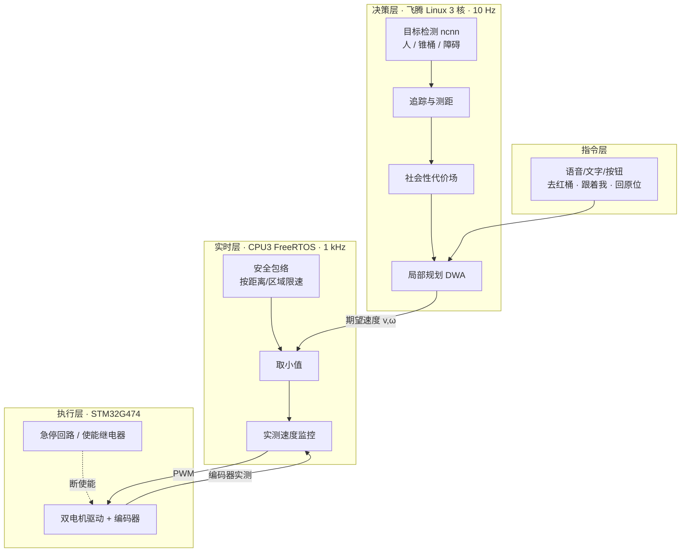

> ⚠️ **本文件已降级为草稿。** 提交推迟至 2027 年 4 月后的现行计划（21 周版本）已写入云端：
> <https://www.workbuddy.cn/space/d/sCDZ4AbiEZLzrBWDvyx3mi> → 文末「十五、计划修订 V2」。
> 本文第十一节的 14 周计划**已作废**，请勿据此排期。

# 「随行」具身移动平台 · 系统方案 V1

| 项 | 内容 |
|---|---|
| 版本 | 2026-11-16 · 全新选题（小车 / 具身智能 / 实物演示） |
| 定位 | 能听懂指令、看得懂人、走得安全的桌面级具身移动平台 |
| 主控 | 飞腾派 CEK8903（ARM64 Linux + CPU3 实时域）+ STM32G474 + ESP32-S3 |
| 赛题 | 集创赛「飞腾」企业命题：基础 40 / 中阶 40 / 高阶 20 |
| 一句话 | **AI 决定"往哪走"，安全包络决定"能走多快"** |

---

## 一、为什么小车适合这个赛题

仓库里与小车直接相关的版块：

| 版块 | 与本项目的关系 |
|---|---|
| 1.1 具身智能与 VLA | 提供"感知→理解→决策→行动"的叙事框架 |
| 1.6 SLAM、感知与状态估计 | 里程计、视觉定位、激光建图（可选） |
| 1.8 SDK 与 DIY | **XLeRobot**（低成本开源移动平台）、rpi-object-detection（视觉流水线） |
| 2.2 嵌入式组件 | EasyLogger / FlashDB / letter-shell / MultiTimer，正好给 MCU 用 |
| 3 架构与 OS | OpenAMP（飞腾官方开源，中阶主证据） |
| 4 机器学习 | ncnn / YOLOX / MNN，板端 CPU 推理 |

相比路口、储能那类"系统级"选题，小车的优势很直接：**它是唯一能自己动起来的东西**。评委不需要想象，车会跑、会停、会绕人。而"具身"的本义就是智能必须长在一个身体上——小车是最低成本的身体。

---

## 二、四条小车路线对比

| 路线 | 前沿性 | 安全契合 | 14 周可行 | 实物感 | 成本 | 资产复用 | 合计 |
|---|---|---|---|---|---|---|---|
| **① 语言引导的社会性导航平台** | 5 | **5** | 4 | 5 | 4 | 4 | **27** |
| ② SLAM 自主导航小车（激光 + ROS2） | 3 | 3 | 5 | 5 | 3 | 5 | 24 |
| ③ 缩比自动驾驶车（车道 + 标志） | 4 | 4 | 4 | 5 | 3 | 3 | 23 |
| ④ 模仿学习小车（LeRobot 风格） | 5 | 2 | 3 | 5 | 4 | 3 | 22 |
| ⑤ 车 + 机械臂复合（XLeRobot 简化） | 5 | 4 | 2 | 5 | 2 | 3 | 21 |

### 为什么选①

| 理由 | 说明 |
|---|---|
| **"社会性导航"是真问题** | 不是"撞不撞"，而是"在人旁边怎么走才让人舒服"——保持距离、不切人、从右侧通过、减速通过。这是具身智能的真实议题，也是移动机器人落地（AGV/配送/陪护）的核心障碍 |
| **安全是刚需** | 人和车共处一个空间，安全不是加分项而是前提。高阶 20 分不用硬凑，直接对应 ISO 3691-4 的思路 |
| **异构有物理意义** | 规划 10 Hz（Linux）、控制 1 kHz（CPU3）、PWM 20 kHz（G474），三个时间尺度天然分层 |
| **演示最强** | 手伸过去车减速停下、人挡路车绕开并保持距离、说"去红桶"车自己过去——三个动作三分钟讲完 |
| **成本可控** | 约 ¥1900，比机械臂复合方案低一半 |

② 太"标准答案"（智能车竞赛年年做），③ 的安全叙事是"别撞人"，比人机共存的舒适性弱，④ 训练数据与 GPU 不确定，⑤ 成本与周期都超预算。

---

## 三、方案定义

### 3.1 三个核心能力

| 能力 | 具体表现 | 技术支撑 |
|---|---|---|
| **听得懂** | "去红色锥桶"、"跟着我"、"回原位" | 指令解析 + 目标检测类别映射 + 目标点管理（不依赖大模型） |
| **看得懂人** | 识别人、估计距离与朝向、判断是否挡路 | 视觉检测 + 单目测距（地面假设）+ 追踪 |
| **走得安全** | 按人机距离动态限速、受控停止、急停 | 安全速度包络 + 双通道校验 + 硬件急停回路 |

### 3.2 三个创新点

| # | 创新点 | 与常见做法差别 |
|---|---|---|
| 1 | **安全包络与规划解耦** | 常见做法是"规划器输出速度直接执行"；本方案规划器只输出期望速度，实时域独立计算"当前允许的最大速度"，**取两者较小值**执行。规划器可以很激进，车永远不超包络 |
| 2 | **社会性代价场** | 障碍不是"圆"，而是带朝向的人形代价场：正面接近代价高、侧后方接近代价低，绕行方向偏好"从人身后过"。比纯几何避障更接近人类预期 |
| 3 | **三个时间尺度分层** | 100 ms 规划 / 1 ms 控制 / 50 µs 驱动，各自跑在最适合的单元上，用数字证明异构必要性 |

### 3.3 五层架构



---

## 四、三个时间尺度（异构的物理依据）

| 层 | 周期 | 跑在哪 | 做什么 | 抖动要求 |
|---|---|---|---|---|
| 规划 | 100 ms（10 Hz） | 飞腾 Linux（CPU0–2） | 检测、追踪、代价场、DWA | 无所谓，200 ms 也能忍 |
| 控制 | **1 ms（1 kHz）** | **CPU3 FreeRTOS** | 包络、取小值、速度环、监控 | **<10 µs** |
| 驱动 | 50 µs（20 kHz PWM） | G474 硬件定时器 | 双电机 PWM、编码器解码 | 硬件保证 |

**这就是中阶 40 分的答案**：不是"我用了 OpenAMP"，而是"规划抖动 200 ms 时，控制环仍是 1 ms 且抖动 <10 µs"。A/B/C 三组对照能把这个差异量出来（见 §7）。

---

## 五、模块选型

### 5.1 底盘与执行

| 件 | 选型 | 理由 |
|---|---|---|
| 底盘 | 铝合金差速底盘，双轮 + 万向轮 | 结构简单、转向半径为零、成本低；比阿克曼少一套转向机构 |
| 电机 | 12 V 减速电机 ×2，带霍尔编码器（≥11 线） | 有编码器才能做速度闭环与打滑检测 |
| 驱动 | TB6612（小电流）或 BTS7960（大电流） | 需支持 PWM + 正反转 + 制动（下桥臂短接） |
| 编码器 | 正交解码，G474 定时器编码器模式 | 硬件解码，不占 CPU |
| 急停 | 蘑菇头急停，**常闭**触点串在使能回路 | 断线即断电，符合失效安全 |

### 5.2 计算单元

| 单元 | 型号 | 职责 | 为什么是它 |
|---|---|---|---|
| 决策 | 飞腾派 CEK8903 4G | 检测、追踪、规划、指令解析、日志 | 赛题指定；3 核跑 Linux 视觉，1 核给实时域 |
| 实时 | STM32G474RET6 | 1 kHz 包络与速度环、安全监控 | 硬件 CRC、双看门狗、CAN-FD（预留）、与 F103 引脚兼容可降级 |
| 观测 | ESP32-S3-N16R8 | 看板、轨迹回放、事件上传 | 独立供电、单向只读，永不参与控制 |

### 5.3 传感器

| 件 | 选型 | 用途 | 备注 |
|---|---|---|---|
| 相机 | USB 广角（120°）UVC，720p | 目标检测、人形识别 | 板上无 CSI，只能 UVC |
| 测距 | VL53L5CX（8×8 多区 ToF）×1–2 | 近距障碍、地面高度 | 比单点超声波抗干扰，比激光雷达便宜 |
| IMU | ICM42688 / MPU6050（I2C） | 航向角、打滑检测 | 挂 G474，1 kHz 采样 |
| 编码器 | 电机自带 | 里程计、速度监控 | 双通道校验的"实测"来源 |
| LiDAR（可选） | RPLIDAR A1 或 C1 | 建图、更稳的避障 | **P2**，不作为主线依赖 |

### 5.4 电源（最容易翻车的地方）

飞腾派要 **12 V/3 A（36 W）**，电机要 12–14.8 V 大电流，两者不能共用一条细线。

```
4S 锂电 14.8V ──┬── 电机驱动（直供，峰值 6 A）
                ├── DC-DC 12V/4A ── 飞腾派（独立，加 π 型滤波）
                └── DC-DC 5V/3A ── G474 / ESP32 / 传感器（再 3.3V LDO）
```

| 要点 | 说明 |
|---|---|
| 电池容量 | ≥5000 mAh（4S），续航约 1–1.5 h；飞腾派满载 10 W + 电机 20 W |
| 共地 | 电机地与逻辑地**单点连接**，避免电机噪声窜入 ADC |
| 欠压保护 | G474 监测电池电压，低于 3.4 V/cell 报警，低于 3.2 V 受控停止 |
| 上电顺序 | 逻辑先起、电机使能后起（避免上电瞬间电压跌落复位飞腾派） |

---

## 六、安全设计（高阶 20 分）

### 6.1 安全速度包络

实时域每 1 ms 计算当前允许的最大速度，规划器的期望速度与之**取小**：

| 人/障碍距离 | 允许速度 | 状态 | 行为 |
|---|---|---|---|
| < 0.5 m | 0 | S2 受控停止 | 减速停车，声光提示 |
| 0.5 – 1.2 m | 0.15 m/s | S1 降速 | 慢速通过，提示音 |
| 1.2 – 2.0 m | 0.15 → 0.8 线性 | S0 正常 | 正常行驶 |
| > 2.0 m | 0.8 m/s | S0 正常 | 巡航上限 |

> 关键：包络的输入是**感知结果**，但计算在**实时域**，且规划器无法修改包络参数。感知被欺骗（检测漏了人）时，ToF 与电流/编码器异常仍会触发降级。

### 6.2 四级状态机

| 级别 | 触发 | 行为 | 恢复 |
|---|---|---|---|
| **S0 正常** | 全链路健康 | 按 min(规划, 包络) 行驶 | — |
| **S1 降速** | 人进入 1.2 m / 规划超时 300 ms | 限速 0.15 m/s，声光提示 | 条件解除自动 |
| **S2 受控停止** | 人 <0.5 m / 障碍 <0.3 m / 电池欠压 | 减速停车（保持使能，可随时再走） | 人工确认或条件解除 |
| **S3 断使能** | 急停 / 实测超速 10% 持续 100 ms / 通信超时 500 ms / 失控 | **继电器断开电机使能 + 下桥臂制动** | 人工复位 |

> S3 与 S2 的区别：S2 是"软件让它停"，S3 是"硬件不让它动"。前者可能被 bug 绕过，后者不会。

### 6.3 双通道校验

| 通道 | 计算方 | 内容 |
|---|---|---|
| A（指令） | Linux 规划器 | 期望 (v, ω) |
| B（包络） | CPU3 | 允许 v_max |
| 执行 | CPU3 | v = min(v_A, v_B) |
| **校验** | CPU3 + G474 | 编码器实测速度 vs 指令速度，偏差 >10% 持续 100 ms → S3 |

### 6.4 失效导向（fail-safe 的方向）

| 失效 | 结果 |
|---|---|
| 断电 | 下桥臂短接制动 + 机械阻尼，**不自由滑行** |
| 急停按下 | 使能继电器断开，电机失电 + 制动 |
| 视觉丢失 | S1 降速 → 300 ms 无恢复 → S2 停 |
| CPU3 死机 | G474 心跳丢失 200 ms → S3 |
| G474 死机 | IWDG 复位；复位期间使能断开 |
| 人突然出现 | ToF 直达路径 <0.5 m → S2（不等视觉结果） |

---

## 七、具身智能怎么做（不吹大模型）

飞腾派 4 GB、无 NPU，跑不动 VLM。硬上就是自欺欺人。所以把"智能"拆成三层，每层用合适的技术：

| 层 | 做法 | 算力需求 | 可行性 |
|---|---|---|---|
| **指令理解** | 模板 + 实体槽位："去{颜色}{物体}"、"跟着{人}"、"回{位置}"；用检测类别表做映射 | 几乎为零 | ✅ 稳 |
| **场景理解** | ncnn 检测（人/锥桶/箱体）+ 单目测距（地面假设）+ 简单追踪 | 320 输入 ~123 ms，8 fps | ✅ 已实测 |
| **行为决策** | 社会性代价场 + DWA 局部规划 | CPU 轻量 | ✅ 稳 |
| **（可选）模仿学习** | 遥操作采 30–50 条轨迹，训练小 ACT 策略，板端推理 | 训练需 GPU，推理 50–100 ms | ⚠️ P2，不影响主线 |
| **（可选）语言 grounding** | PC 端跑 CLIP 做开放词汇匹配 | 不在板上 | ⚠️ P2 |

**答辩时的说法**：不是"我们没能力跑大模型"，而是"我们把算力放在了正确的地方——实时控制要确定性，语义理解可以离线"。这个取舍本身就是工程判断。

---

## 八、开源整合

| 项目 | 落位 | 用法 | 对应 |
|---|---|---|---|
| **OpenAMP + Phytium FreeRTOS SDK** | CPU3 | 1 kHz 包络与速度环，RPMsg 收规划指令 | **中阶主证据** |
| **ncnn** | Linux | 人/锥桶/障碍检测，320 输入 | 基础 |
| **YOLOX** | PC 训练→ONNX | 检测模型 | 基础 |
| **XLeRobot** | 结构参考 | 低成本移动平台的分层与走线思路（不直接复刻） | 基础 |
| **rpi-object-detection** | Linux | 取图→预处理→推理→输出的流水线骨架 | 基础 |
| **EasyLogger** | 三端 | 统一日志，便于故障对齐 | 高阶 |
| **FlashDB** | G474/ESP32 | 轨迹索引、故障计数（掉电不丢） | 高阶 |
| **letter-shell** | G474 | 现场命令：读编码器、强制 S2、标定 | 高阶 |
| **MultiTimer** | G474/CPU3 | 去抖、超时、心跳 | 基础 |
| **libhv** | Linux | 轨迹回放看板（WebSocket 推位姿） | 基础 |
| **LVGL** | ESP32-S3 | 本地状态屏（速度/状态/电量） | 基础 |
| **MuJoCo / Gazebo**（PC 侧） | 仿真预演 | 先仿真调 DWA 参数，再上实车 | 降风险 |
| 不采用 | RT-Thread / hvisor / VLA 大模型 | 推翻已通 OpenAMP / 板上跑不动 | — |

---

## 九、赛题对应

| 层级 | 分值 | 答案 | 证据 |
|---|---|---|---|
| **基础** | 40 | 完整具身闭环：指令 → 检测 → 规划 → 包络 → 电机 → 编码器反馈；前沿技术为**语言引导 + 视觉感知 + 社会性导航** | 三段演示视频（听指令去目标 / 绕人保持距离 / 手伸过去停车）、8 fps 检测数据 |
| **中阶** | 40 | **深度融合 OpenAMP**：10 Hz 规划在 Linux、1 kHz 控制在 CPU3，核级隔离 | A/B/C 三组抖动曲线 + 视觉满载时的控制稳定性 + `remoteproc0` 日志 |
| **高阶** | 20 | 安全包络 + 四级状态机 + 双通道校验 + 硬件急停 + 12 条 FIT | 覆盖矩阵、FMEA、FIT 报告、验证报告 |

### 高阶 FIT 用例（每条都能现场演）

| 编号 | 注入 | 期望 |
|---|---|---|
| FIT-01 | 手伸到车前 0.4 m | 300 ms 内 S2 停，不接触 |
| FIT-02 | 快速横穿（模拟突然出现） | ToF 触发 S2，不等视觉 |
| FIT-03 | 遮住相机 | 1 s 内 S1 降速 → 3 s 内 S2 |
| FIT-04 | `kill -9` 规划进程 | 300 ms 内 S1 → 3 s 内 S2 |
| FIT-05 | `echo stop > remoteproc0/state` | 200 ms 内 S3 断使能 |
| FIT-06 | 按急停 | 立即断使能 + 制动 |
| FIT-07 | 拔编码器线 | 实测速度失真 → 100 ms 内 S3 |
| FIT-08 | 强制超速（改包络） | 偏差 10% 持续 100 ms → S3 |
| FIT-09 | 电池降到 3.2 V/cell | 先报警，后 S2 |
| FIT-10 | 地面打滑（洒水/垫纸） | 打滑检测（编码器 vs IMU）→ 降速 |
| FIT-11 | 断电 | 制动而非滑行；重启后状态自检 |
| FIT-12 | CPU 满载（视觉 stress） | 控制周期抖动仍 <10 µs |

---

## 十、指标与验收

| 指标 | 目标 | 测法 |
|---|---|---|
| 控制周期抖动 | P99 <10 µs | 逻辑分析仪打 GPIO 翻转 |
| 规划频率 | ≥8 Hz | 日志计数 |
| 检测延迟 | ≤150 ms | 时间戳 |
| 人距 0.5 m 停车响应 | ≤300 ms | 高速摄像/示波器 |
| 急停响应 | ≤50 ms | 示波器测使能信号 |
| 打滑检出 | ≤200 ms | 编码器 vs IMU 偏差 |
| 续航 | ≥60 min | 实测 |
| 社会距离保持 | 绕行时人车距离 ≥0.8 m | 卷尺/轨迹回放 |
| 连续运行 | 2 h 无重启 | 挂机 |

---

## 十一、14 周计划

| 周 | 主线 | 交付 |
|---|---|---|
| W1 | 安全目标定义（参考 ISO 3691-4 思路）、包络参数、架构评审 | 安全需求表、包络曲线 |
| W2 | 底盘装配 + G474 双电机 1 kHz 闭环 + 编码器 | 车能定速直行、原地转 |
| W3 | CPU3 实时域：包络 + 取小值 + 双通道 | 改包络能限速 |
| W4 | 相机接入 + 检测跑通（人/锥桶） | 检测可视化、8 fps |
| W5 | 测距（ToF）+ 追踪 + 社会性代价场 | 人能被人形框跟住 |
| W6 | DWA 局部规划 + 目标点到达 | 点哪去哪（无障碍） |
| W7 | 绕人实验 + 参数调优 | 人机距离 ≥0.8 m |
| W8 | **三组对照实验** | 抖动曲线（中阶达成） |
| W9 | 指令解析 + 三种指令 + 状态机 | 说指令能执行 |
| W10 | 急停回路 + 12 条 FIT | 注入日志 |
| W11 | FMEA + 覆盖矩阵 + 验证报告 | 高阶四件套 |
| W12 | 续航/稳定性/轨迹回放 | 2 h 曲线 |
| W13 | 视频 + PPT | 提交包 |
| W14 | 答辩演练 | 定稿 |

**关键路径**：W2 电机闭环 → W3 包络。车不会稳稳地按速度走，后面全是空谈。

---

## 十二、BOM

| 件 | 数量 | 估价 | 备注 |
|---|---|---|---|
| 铝合金差速底盘 | 1 | ¥450 | 含万向轮、支架 |
| 12 V 编码器减速电机 | 2 | ¥220 | ≥11 线霍尔 |
| 电机驱动（BTS7960/TB6612） | 2 | ¥80 | 支持制动 |
| 4S 锂电 5000 mAh + 充电器 | 1 | ¥300 | — |
| DC-DC 12V/4A、5V/3A | 2 | ¥120 | 关键件，别省 |
| 飞腾派 CEK8903 | 1 | 已有 | — |
| STM32G474 板 | 1 | ¥150 | NUCLEO-G474RE |
| ESP32-S3-N16R8 + 1.3" 屏 | 1 | ¥90 | — |
| USB 广角相机 | 1 | ¥150 | 120° |
| VL53L5CX ToF | 2 | ¥160 | 8×8 多区 |
| IMU（ICM42688） | 1 | ¥30 | — |
| 急停开关 + 继电器 | 1 | ¥50 | 常闭 |
| 声光（蜂鸣器 + RGB 灯带） | 1 | ¥40 | 安全提示必需 |
| 结构件/线束/接插件 | — | ¥200 | — |
| **合计** | | **≈¥2040** | 不含飞腾派 |
| 可选：RPLIDAR A1 | 1 | ¥450 | P2 |

---

## 十三、风险

| 风险 | 概率 | 应对 |
|---|---|---|
| 底盘到货延迟 | 中 | 先用现成小车底盘（如亚克力三轮）改，接口不变 |
| 电源噪声导致飞腾派复位 | **高** | 12 V 独立 DC-DC + π 滤波 + 电机地单点连接；这是最常见的翻车点 |
| 编码器抖动/丢脉冲 | 中 | 硬件正交解码 + 软件滤波；FIT-07 专门测 |
| 地面材质影响（打滑） | 中 | 打滑检测 + 降速；演示地面固定为瓷砖/木地板 |
| 社会性导航调参耗时 | 高 | 先仿真（Gazebo）调参，再上实车；参数不超过 6 个 |
| 检测帧率不足 | 中 | 320 输入 + 8 fps；低速（0.3 m/s）下 8 fps 足够 |
| 14 周做不完绕人 | 中 | 保底只做"停"不做"绕"——S2 停车已能拿安全分，绕行是加分 |

---

## 十四、与「路口守卫」方案的关系

如果两个方案只能留一个，我的建议是**这个**。理由：

| 维度 | 路口守卫 | 随行平台 |
|---|---|---|
| 实物感 | 沙盘演示，仍是"模型" | **真车在地上跑** |
| 具身叙事 | 弱（路口不是身体） | **强（车就是身体）** |
| 成本 | ¥1330 | ¥2040 |
| 工程量 | 灯组 12 路 + 沙盘 | 底盘 + 电机环 + 规划 |
| 安全契合 | 强（绿冲突） | 强（人机共存） |
| 上手难度 | 低 | 中 |

三域分离、双通道、失效安全这些思想可以平移，但**状态机、安全包络、硬件全部要重写**——不是改改就能用的。

---

*本文档为全新选题，仅复用底层能力（ncnn 推理、OpenAMP、协议帧、ESP32 遥测、交叉工具链）。所有参数为设计目标，需在 W2–W8 实测校准；安全设计参考 ISO 3691-4 的思路，不构成合规声明。*
