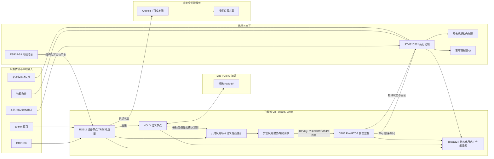

# “随行”辅助出行系统：研电赛飞腾杯＋集创赛冲击国一总纲 V1.1

> 更新日期：2026-11-19\
> 目标赛事：2026 年第二十一届中国研究生电子设计竞赛“飞腾”命题（赛题一）＋2026 年第十届全国大学生集成电路创新创业大赛“飞腾”企业命题\
> 团队类型：研究生团队\
> 文档定位：一套共用实物与代码基线，两套竞赛叙事和证据包\
> 结论边界：本文给出“具备冲击国一条件”所需的工程路线和验收门禁，不承诺奖项结果。

V1.1 变更：ROS 2 纳入飞腾 Linux 应用主架构；YOLO 与 AI 加速卡纳入复杂场景语义增强。语义识别不替代双目/雷达几何风险场，也不直接产生运动许可。

## 0. 文档使用规则

### 0.1 证据状态

本文用四种状态区分事实与计划，避免把设想写成成果：

- **已确认（C）**：用户已确认的板卡、型号或需求。
- **已验证（V）**：本地代码、测试或生成物已经复核。
- **待实现（P）**：技术路径已有依据，但尚未形成实机证据。
- **待确认（Q）**：缺少准确型号、规则原文或实测数据，冻结前必须补齐。

竞赛论文、PPT、视频中只能把 C/V 项写成“已有成果”；P/Q 项只能写成“计划、设计或待验证”。开源项目、论文和厂商 SDK 必须注明来源，不能把复用部分包装为团队创新。

### 0.2 一套平台、两套证据包

共用部分包括：整机、飞腾派 V3、感知与风险融合、OpenAMP 安全监督、STM32 执行控制、ESP32-S3 语音、手机端位置共享、测试系统和源代码。

两项赛事只调整材料重心：

| 赛道 | 核心叙事 | 必须强化的证据 |
|---|---|---|
| 研电赛飞腾杯 | 面向视障人士复杂动态出行场景的完整电子系统 | 实物完整性、创新/创意、功能稳定演示、真实应用价值、技术报告 |
| 集创赛飞腾企业命题 | 基于飞腾多核与开源生态的安全可靠芯片应用系统 | 多核任务划分、OpenAMP 深度融合、性能优化、需求—测试覆盖、风险分析、FIT 与复杂环境验证 |

## 1. 赛事依据与国一判据

### 1.1 研电赛飞腾杯

2026 年研电赛“飞腾”命题赛题一要求基于飞腾 CPU 构建完整电子系统，鼓励深入真实行业场景，充分利用飞腾算力，可采用异构架构，并兼顾创新性与实用性。正式交付物包括技术报告、PPT、5–10 分钟演示视频、源代码或可执行文件及可现场展示的实物。

该命题公开评分结构为：技术论文 10 分、作品展示与功能完整性 30 分、创新/创意 40 分、应用价值 20 分。因此，本项目不能只做“能动的小车”，必须同时形成可复现实验、稳定演示、创新对比和真实用户价值证据。

### 1.2 集创赛飞腾企业命题

2026 年飞腾官方说明确认该赛题采用三级任务体系，并特别强调真实应用场景中的安全可靠性设计。用户提供的赛题原文进一步明确：

1. 基础任务要求飞腾平台上的完整创新应用，至少包含一项前沿技术或复杂处理功能；
2. 中阶任务要求深度融合飞腾开源软件并释放多核性能，例如 OpenAMP 或 Jailhouse；
3. 高阶任务要求功能规范—测试覆盖对应、芯片应用风险分析、基于飞腾芯片的风险管控、故障注入测试（FIT）及复杂环境验证。

当前官网的第十届赛题正文以图片发布，本文把用户提供的文字作为工作基线。提交前必须从赛事群或官方附件保存原始赛题文件并逐条复核；第九届评分表只能用于理解评分结构，不能替代第十届最终规则。

### 1.3 “冲击国一”最低门禁

以下任一项未通过，只能称为“概念原型”，不能称为国一就绪：

- G0：准确冻结传感器、电机、驱动、电池、制动、手柄输入和音频器件的型号与接口；
- G1：整机在断电、急停、通信丢失、传感失效时具有明确且实测的安全状态；
- G2：现有 COIN-D6、双目相机与 ROS 2 传感链在飞腾派上连续运行，时间戳、TF、盲区和拒绝策略可验证；
- G3：YOLO 语义增强与无类别几何风险融合完成消融验证；动态横穿风险、转向引导和制动形成从传感输入到轮端反馈的实机闭环；
- G4：OpenAMP 不是示例程序，而是承载真实的风险摘要、运动许可和执行回执；
- G5：提供“单传感器/融合”“当前距离/TTC 预测”“Linux 单域/飞腾实时监督”等基线或消融对比；
- G6：功能规范与测试用例全量对应，FIT 有输入、期望、实测时序、日志和结论；
- G7：形成稳定的 5–10 分钟现场演示脚本、断网演示模式和可恢复备机/镜像；
- G8：在受控真实场景取得重复实验数据；涉及视障用户的测试须经过指导教师和学校适用的伦理、安全与知情同意流程。

## 2. 项目目标与范围

### 2.1 一句话目标

构建一台由使用者主导行走、由飞腾多核系统提供有限转向助力和危险制动的辅助出行设备；系统以现有双目与二维激光雷达形成不依赖类别的几何风险底座，并用 YOLO 对行人、两轮车等复杂动态场景提供语义增强，预测前方占用、危险趋势和可通行方向，通过左右握把力觉/震动和语音向使用者反馈。

### 2.2 目标用户与核心场景

- 目标用户：视障人士和盲人；当前阶段先由健视测试人员在封闭场地完成安全验证。
- 核心场景：人行道、校园道路、园区道路、路口等待与通过、狭窄通道、动态行人或电动车突然横穿。
- 核心交互：使用者握持并推动设备；系统只在使用者已有运动/转向意图时提供有限助力；突发危险时制动并高优先级震动。
- 扩展场景：手机端显示实时位置与历史轨迹，经授权与家人共享；离线语音用于设置目的地、查询状态、重复提示和求助。

### 2.3 明确纳入范围

1. 两驱差速、普通轮胎、前部被动脚轮的辅助推行底盘；
2. COIN-D6 二维激光雷达和现有 60 mm 基线双目相机，不新增或替换传感器类型；
3. ROS 2 传感节点、TF、诊断、rosbag2 数据集回放和模块生命周期管理；
4. 无类别障碍占用、相对运动、危险趋势和通行方向估计；
5. YOLO＋AI 加速卡的行人、两轮车等语义增强，以及语义—深度—雷达的时空关联；
6. 左/右转辅助、限速、制动、急停、失联停车和执行反馈；
7. 左右握把震动、离线语音、只读状态监护；
8. Android 手机定位、百度地图展示、轨迹记录和家属授权共享；
9. 飞腾 Linux＋保留核 FreeRTOS＋OpenAMP/RPMsg＋STM32C532 的分层安全链；
10. 需求追踪、性能测量、日志、风险分析、FIT 和演示材料。

### 2.4 明确排除范围

- 不实现无人状态下的全自动驾驶、远程驾驶或自主“召回到人前”；
- 语音命令不得直接变成电机 PWM、速度或转角命令；“小车过来”不在当前安全范围；
- 家属端、云端和百度地图服务不得进入实时运动许可链；
- 不承诺开放道路、机动车道、楼梯、无护栏站台、强降雨或法规未覆盖场景的独立使用；
- 不启用 Nav2 自主导航，不允许 ROS 2 网络话题、YOLO 类别或置信度直接形成电机命令；
- 不把 Jailhouse、LLM 或云语音作为主线依赖；
- 不在缺少实测覆盖的区域宣称“检测到所有障碍”或“可替代盲杖/导盲犬”。

## 3. 当前基线与差距

### 3.1 已有硬件

| 硬件 | 状态 | 拟定职责 | 当前边界 |
|---|---|---|---|
| 飞腾派 V3，4 GB | C | Linux 感知、融合、日志、手机通信；保留核运行 FreeRTOS 安全监督 | 实际系统镜像、内核、SDK 和 OpenAMP 启动链需重新采集证据 |
| ESP32-S3 N16R8 | C | ESP-SR 离线唤醒、命令词识别、提示音控制 | 麦克风/音频前端、功放和扬声器型号未冻结 |
| STM32C532CCT6 | C | 电机闭环、编码器、手柄输入、急停状态、飞腾失联保护 | 自制板/开发板、引脚、收发器和驱动接口未冻结 |
| COIN-D6 | C（来自当前项目基线） | 水平扫描平面的占用与相对运动证据 | 串口协议、扫描时序、户外抗光和装车遮挡需实测 |
| 60 mm 基线双目 | C（类型/基线）＋Q（SKU） | 前向深度、低矮区域与动态趋势补充 | 准确 SKU、同步方式、视频格式和 ARM64 取流尚不明确 |
| AI 加速卡 | P＋Q（型号待冻结） | YOLO 语义推理，降低飞腾 Linux CPU 占用 | 推荐验证 Hailo-8R Mini PCIe；驱动、供电、散热和模型工具链尚未在飞腾派 V3 实测 |

### 3.2 当前机械基线 V4

- 450 mm × 350 mm 车身包络；候选驱动轮直径 180 mm；
- 两只普通橡胶驱动轮独立驱动，前部两只被动脚轮；
- 双目镜头中心约 600 mm；COIN-D6 名义扫描平面约 655 mm；握持中心约 950 mm；
- STEP 包含 41 个命名组件，静态干涉与脚轮扫掠干涉检查为零；
- 扶手立柱在雷达后向形成两段小遮挡，高位雷达无法可靠覆盖低于扫描平面的全部障碍和落差；
- 轮胎、电机、脚轮接口、载荷、重心、制动距离、扶手刚度、伸缩锁止和防夹结构尚未用实物确认。

机械基线见：[V4 两驱高位感知概念装配](rover-v1-20261116/cad-v4-two-drive/README.md)。

### 3.3 当前软件基线

已存在 `contracts.py`、`fusion.py`、`supervisor.py`、`replay.py` 与 JSONL 场景回放；本轮执行 `python -m unittest -v test_assist`，10 项测试全部通过，覆盖横穿制动、单源危险、旧数据拒绝、握持/转向意图、急停、停车锁存、本地重新确认和监护端只读隔离。

当前交付还包括 [M1 v0.1 合成交接包](../samples/m1-handoff-v0.1/README.md) 与 [Android 16 应用](../android/suixing-app/README.md)。Ubuntu Jammy、RPMsg、YOLO 和 ESP-SR 的工具链证据及待实机验收范围见[开发与验收基线](开发与验收基线.md)。整车集成仍待完成以下工作。

- COIN-D6 与双目实机驱动、标定、时间同步和冻结检测；
- 飞腾派 Ubuntu 22.04/ROS 2 Humble 比赛镜像、实采传感节点、TF 与节点健康管理；
- 项目数据微调、Hailo 转换和驱动、ROS 2 推理节点与语义关联；
- 飞腾端 C/C++ 实时数据流水线；
- “随行”业务的 OpenAMP/RPMsg 消息与性能测试；
- STM32 电机闭环、制动、急停、看门狗和执行回读；
- ESP32-S3 实际音频链；
- Android 实车只读数据、风险事件对齐和家属授权共享；
- 台架制动、复杂动态场景、需求覆盖和 FIT 实测。

飞腾派 V3 已完成通用 Linux／CPU3 RPMsg 回环。随行风险摘要、许可和执行回读的业务链仍待上板验收。

## 4. 调整后的系统架构



### 4.1 架构原则

1. **人始终是运动发起者。** 没有握持、运动和同向转向意图，就不给转向助力。
2. **危险权限高于导航。** 急停、制动和危险震动覆盖普通方向提示与语音。
3. **旧数据等同无数据。** 每条安全相关消息必须含会话、版本、序号、采样时间、有效期和质量；超时即失效。
4. **语义只增强，不放行。** YOLO 可以提高复杂动态目标的风险权重和语音描述，但类别缺失、误检或加速卡掉线不能把未知区域判为安全。
5. **ROS 2 不进入最终安全裁决。** ROS 2 负责 Linux 域模块通信、TF、诊断和数据回放；CPU3 对收到的摘要独立检查有效期与状态，STM32 保留本地急停和失联保护。
6. **图像不跨核。** Linux 保留图像和点云，只通过 RPMsg 发送小型风险摘要，避免共享内存带宽成为伪创新。
7. **外部网络不参与控车。** App、百度地图、MQTT 和家属端只读；断网不影响本地制动。
8. **执行必须回读。** 区分“发出制动请求、STM32 接收、驱动起效、轮速为零”四个时刻。
9. **单点故障有明确结果。** YOLO/AI 卡故障、ROS 2 节点退出、Linux 卡死、RPMsg 丢包、STM32 失联、传感冻结和 App 掉线分别定义降级或停车行为。

### 4.2 模块边界

| 模块 | 单一职责 | 主要输入/输出 | 故障动作 |
|---|---|---|---|
| M1 ROS 2 设备与时空层 | 隔离 D6、双目、轮速和手柄协议；发布标准消息、TF 和诊断 | 原始帧/扫描 → 带时间、坐标和质量的统一观测 | 标记该源无效，不伪造距离；节点异常上报 |
| M2 YOLO 语义增强 | 在 AI 加速卡上识别/跟踪行人、两轮车等动态目标 | 图像 → 带时间、类别、置信度、框/掩膜和跟踪状态的语义观测 | 超时或掉卡即退出语义加权，不清除几何危险 |
| M3 风险场融合 | 估计占用、相对运动、TTC 与直/左/右扫掠风险；关联语义与深度/雷达 | 统一观测＋语义观测 → `RiskSummary` | 关键覆盖不足时进入未知/限速/停车 |
| M4 人机协同决策 | 把用户意图、风险和路径提示合成为辅助请求 | 风险＋握持/转向意图 → `AssistRequest` | 不满足授权条件则零助力 |
| M5 飞腾实时监督 | 检查有效期、状态机、限幅、心跳和恢复门禁 | `RiskSummary`＋执行回读 → `MotionPermit` | 过期、异常或状态不一致时撤销许可/制动 |
| M6 STM32 执行 | 双轮闭环、制动、急停、失联保护和轮速回读 | `MotionPermit`＋本地输入 → 电机/制动/反馈 | 飞腾失联或急停时本地进入安全状态 |
| M7 多模态交互 | 左右震动、危险震动、离线语音和提示音 | 风险/导航/状态 → 触觉与语音 | 危险提示抢占普通提示，语音故障不影响制动 |
| M8 手机与地图 | 手机定位、百度地图显示、轨迹和家属授权共享 | 手机位置＋只读车况 → 地图/共享 | 断网缓存或停止上传，不发送运动命令 |
| M9 证据系统 | rosbag2、结构化日志、版本、测试覆盖、性能和 FIT 证据 | 三端事件 → 可追溯实验包 | 录包/日志限流，不阻塞安全任务 |

## 5. 功能清单、优先级与验收证据

### 5.1 优先级定义

- **P0 安全闭环**：未完成不得进行有人动态行走测试。
- **P1 国一完整度**：未完成不得宣称具备冲击国一的完整条件。
- **P2 增强项**：在 P0/P1 稳定后用于提升展示、论文深度或产品化潜力。

### 5.2 P0：安全闭环

| ID | 功能 | 验收证据 |
|---|---|---|
| P0-01 | 上电默认零助力，启动时按住确认键不能直接解锁 | 状态机测试＋实机上电视频＋日志 |
| P0-02 | D6、双目、轮速、手柄统一单调时钟、序号、质量和有效期 | 冻结/倒序/未来时间注入测试 |
| P0-03 | 几何安全底座不依赖类别，持续输出占用、接近趋势、TTC 和直/左/右风险 | 场景回放＋实景标注对照；关闭 YOLO 后仍能触发危险 |
| P0-04 | 动态横穿风险在进入人车联合扫掠区前触发升级 | 多速度、多方向重复试验及延迟分布 |
| P0-05 | 仅当握持、已运动、同向意图和安全条件同时满足时给转向助力 | 台架和推行测试，逐条件撤销 |
| P0-06 | 助力有速度、加速度、差速和持续时间上限 | 参数表＋极值测试＋轮速记录 |
| P0-07 | 突发危险请求制动并触发双侧高优先级震动 | 传感到震动/制动/停车四段时延 |
| P0-08 | 物理急停直接进入 STM32 本地安全状态 | 断开飞腾仍可急停的台架测试 |
| P0-09 | Linux/RPMsg/飞腾实时核/STM32 任一通信超时均有定义动作 | 分段断连 FIT＋恢复门禁测试 |
| P0-10 | 停车锁存后必须零速、观测有效且本地确认上升沿才能恢复 | 自动化状态机测试＋实机验证 |
| P0-11 | 执行端回传接收、制动起效、实际轮速和故障 | 三端对时日志与示波/逻辑分析证据 |
| P0-12 | 左、右、危险三类震动可区分且危险模式可抢占 | 盲测辨识率和误触统计；阈值由实测冻结 |
| P0-13 | 未知区域不被解释为安全区域 | 遮挡、无回波、相机冻结、低纹理测试 |
| P0-14 | 高位传感器对低矮障碍和落差的能力边界明确 | 标准障碍高度/距离矩阵；未覆盖场景限制说明 |
| P0-15 | YOLO、AI 加速卡或 ROS 2 语义节点退出时不得解除已有危险或产生放行 | 杀节点、掉卡、超时、错误类别与低置信度故障注入 |

### 5.3 P1：国一完整度

| ID | 功能 | 验收证据 |
|---|---|---|
| P1-01 | 飞腾 Linux 与 CPU3 FreeRTOS 运行真实业务 OpenAMP | 启动链、资源表、RPMsg 抓取、往返延迟与丢包统计 |
| P1-02 | 多核任务分配和资源优化 | 逐核 CPU、内存、缓存/拷贝、队列、帧率和最坏时延对比 |
| P1-03 | 离线语音唤醒、固定命令词、状态播报 | 噪声/口音/距离测试；语音只生成非运动任务 |
| P1-04 | Android 手机实时位置、百度地图轨迹和历史回放 | App 录屏、断网缓存、权限与隐私流程 |
| P1-05 | 家属授权共享位置和只读车况 | 双账号/双端演示、撤销授权、TLS 与访问控制测试 |
| P1-06 | 实时轨迹与本地风险状态在监护界面可视化 | 时间对齐的地图/风险/事件回放 |
| P1-07 | 功能规范—测试用例—结果—证据全量追踪 | 可审计追踪矩阵，无孤立功能或无来源用例 |
| P1-08 | 基于飞腾芯片应用的风险分析与 FIT | 至少覆盖 CPU 饱和、进程退出、RPMsg 损坏/超时、传感冻结、实时核卡死 |
| P1-09 | 真实复杂动态场景重复实验 | 每场景多轮重复，报告分布而非单次最好结果 |
| P1-10 | 基线与消融实验 | 单源/融合、距离/TTC、无/有实时监督、多核配置前后对比 |
| P1-11 | 一键部署、版本锁、离线演示和恢复镜像 | 新存储介质复装演练＋比赛断网彩排 |
| P1-12 | 双赛道材料包 | 研电赛技术报告/PPT/视频/代码/实物；集创赛文档/代码/测试/FIT/展示包 |
| P1-13 | ROS 2 Humble 节点化传感、TF、诊断、生命周期和 rosbag2 回放 | 节点图、接口定义、TF 树、QoS/队列策略、录包重放一致性 |
| P1-14 | YOLO 复杂场景语义增强与 AI 卡异构推理 | 自建/公开测试集、CPU/加速卡对比、YOLO 开/关消融、误检漏检与端到端时延 |

### 5.4 P2：增强项

- 可调相机俯角、可调手柄及防夹/锁止结构；
- 运行中传感器外参健康检查和镜头遮挡提示；
- 受控场地的辅助路径提示与离线路线缓存；
- 电池健康、温度和维护提醒；
- AI 卡驱动或模型转换受阻时，以 ncnn/ARM NEON 作为可复现的 CPU 推理降级基线，不作为最终性能结论；
- 经实际隔离需求证明有必要后，再评估 Jailhouse/hvisor，不作为首版比赛主线。

## 6. 技术选型与依据

| 功能 | 选型 | 依据与边界 |
|---|---|---|
| 主计算域 | 飞腾派 V3 4 GB；Ubuntu 22.04＋ROS 2 Humble；C++17 负责设备和融合，Python 主要用于模型工具、回放与分析 | 已有飞腾派社区项目验证 Ubuntu 22.04、ROS 2 Humble、FreeRTOS 与 OpenAMP 组合；正式镜像仍需在本板复现 |
| Linux 中间件 | ROS 2 Humble：`rclcpp`、`sensor_msgs`、`vision_msgs`、TF2、image_transport、diagnostic_updater、rosbag2 | 只用于 Linux 域模块解耦、时空关系、诊断和回放，不使用 Nav2 自主控车；安全摘要仍经 OpenAMP 进入 CPU3 |
| 视觉几何 | OpenCV 4.x：标定、校正、StereoSGBM/深度质量、光流或几何跟踪 | OpenCV 上游提供双目标定与视差算法；选择 4.x 是为成熟兼容性，精确提交在 ARM64 构建通过后锁定 |
| 语义感知 | YOLOv8n 起步＋定制数据微调；ROS 2 节点发布 `vision_msgs/Detection2DArray` 或等价自定义消息 | YOLOv8n 成熟、轻量且 Hailo Model Zoo 有配置；先覆盖 person/bicycle/motorcycle 等基线类别，再以本项目数据验证电动车等目标，不能把未训练类别写成已支持 |
| AI 加速 | 首选验证 Hailo-8R Mini PCIe 13 TOPS；HailoRT `hailo8` 分支＋Hailo-8/8L 对应 Model Zoo v2.x/DFC 3.x | 飞腾派提供标准 Mini PCIe x1，Hailo-8R 为 Full-Mini、PCIe Gen3 x1、ARM/Linux；实际内核驱动、3.3 V 供电、散热和 HEF 模型必须上板验收后才能采购冻结 |
| 激光处理 | COIN-D6 原生串口解析＋扫描时序补偿＋局部占用 | 保留当前型号；不引入第二套雷达驱动框架。无回波、自遮挡与丢帧保持未知 |
| 风险估计 | 时间对齐的占用栅格/扇区＋相对速度＋TTC＋人车联合扫掠包络＋语义风险加权 | 几何层直接回答危险趋势，YOLO 只提高已关联动态目标的风险先验和播报信息；未识别目标仍按几何风险处理 |
| 多核通信 | 飞腾官方 FreeRTOS/Standalone SDK＋OpenAMP/RPMsg＋libmetal | OpenAMP 上游实现 RPMsg、Virtio、Remoteproc；飞腾板级工程以官方 SDK 和本地 V1.7.1 手册为准 |
| 实时安全域 | CPU3 FreeRTOS：有效期检查、状态机、限幅、心跳、运动许可 | 与集创赛中阶/高阶要求和现有路径一致。通用 RPMsg 经验不能替代业务闭环实测 |
| 执行控制 | STM32C532CCT6＋STM32CubeC5 HAL/LL＋定时器/编码器/看门狗 | STM32CubeC5 是 ST 官方 C5 软件包；电机、驱动和制动未冻结前不写死 PWM/CAN 接口 |
| 离线语音 | ESP-IDF 5.4 验证起点＋ESP-SR AFE/WakeNet/MultiNet | ESP-SR 官方支持 ESP32-S3，组件声明 ESP-IDF ≥5.0，上游 CI 有 ESP32-S3/IDF 5.4 组合；只做有限命令词和播报 |
| 手机地图 | Android 原生 Java＋系统 LocationManager＋百度 Map／Util 9.0.0 | 手机 GPS 以 WGS84 存储，渲染转换为 BD09LL。接入百度底图时配置 Android AK 并完成隐私同意。 |
| 家属共享 | Eclipse Mosquitto＋Paho Android，MQTT over TLS，细粒度 ACL | 位置是低频状态流，MQTT 适合发布/订阅；只读车况与运动通道物理/逻辑隔离。服务部署位置仍需确认 |
| 事件证据 | Linux 结构化 JSONL/二进制日志＋CPU3/STM32 固定长度环形事件 | 可统一会话、序号和时间，且日志限流不阻塞安全路径 |
| 主机测试 | 现有 Python `unittest`＋CMake/CTest/GoogleTest＋gcovr | 保留已通过的 10 项状态机测试；C/C++ 纯逻辑在主机测试并生成覆盖率 |
| 嵌入式测试 | ThrowTheSwitch/Unity＋HIL 台架＋故障注入开关 | Unity 适合纯 C 单元测试；硬件时序和制动必须用 HIL/实物测量，不能由单元测试替代 |

### 6.1 明确不选的主线技术

| 技术 | 当前不选原因 | 重新评估条件 |
|---|---|---|
| Nav2/自主导航 | 项目是使用者主导的辅助设备；完整自主规划会改变安全范围和法规责任 | 仅在未来独立项目重新完成需求与风险论证后 |
| YOLO 直接控制/类别放行 | 漏检、未知类别和域外场景不可避免；语义网络不能证明自由空间安全 | 不重新评估；始终由几何覆盖、CPU3 和 STM32 决定运动许可 |
| Jailhouse/hvisor | 启动链、外设分区和验证成本高；OpenAMP 已能形成清晰的比赛主线 | OpenAMP 无法满足明确的隔离或确定性指标时 |
| LLM/云语音 | 网络不可用会破坏交互，且与安全问题无直接关系 | 作为非安全关键的可选问答，不参与运动控制 |
| 大型多模态/开放词汇模型 | 4 GB 主机和比赛稳定性不适合；对 P0 制动没有必要性 | 仅作离线研究，不进入比赛实时链 |

## 7. 需要下载的软件和依赖

### 7.1 飞腾派与通用开发

| 软件/依赖 | 用途 | 来源 | 版本策略 |
|---|---|---|---|
| 飞腾派 Ubuntu 22.04 镜像、BSP、设备树 | ROS 2 Humble、板卡启动和外设 | 飞腾官方资料及 `phytium-linux-buildroot` | 备份现板后在独立 SD 卡构建比赛镜像；保留可回退介质 |
| ROS 2 Humble `ros-base` | Linux 域通信、TF、诊断、rosbag2 | <https://docs.ros.org/en/humble/> | 使用 Ubuntu 22.04 ARM64 官方包；只安装所需包并锁 rosdep/apt 清单 |
| `rclcpp`、TF2、image_transport、vision_msgs、diagnostic_updater、rosbag2 | ROS 2 节点和接口 | ROS 2 官方仓库/Ubuntu ROS 仓库 | 与 Humble 发行版一致，不混用 rolling 默认分支 |
| Phytium-FreeRTOS-SDK | CPU3 FreeRTOS 与 OpenAMP 板级工程 | <https://gitee.com/phytium_embedded/phytium-free-rtos-sdk> | 使用目标板验证过的发布分支并记录提交号 |
| Phytium-Standalone-SDK | 飞腾裸机驱动底座 | 飞腾嵌入式开源社区 | 与 FreeRTOS SDK/BSP 配套冻结 |
| OpenAMP | RPMsg/Virtio/Remoteproc 上游参考 | <https://github.com/OpenAMP/open-amp> | 不直接替换飞腾适配层；记录飞腾 SDK 所含版本 |
| libmetal | Linux/RTOS/裸机抽象层 | <https://github.com/OpenAMP/libmetal> | 与 OpenAMP 配套 |
| OpenCV 4.x | 双目标定、校正、视差与几何处理 | <https://github.com/opencv/opencv/tree/4.x> | 先查板上包；必要时只构建所需模块并锁定提交 |
| Ultralytics YOLO | 训练、验证和导出 YOLOv8n | <https://github.com/ultralytics/ultralytics> | 在 x86 开发机独立环境锁版本；注意 AGPL-3.0/企业许可，不把完整 PyTorch 部署到飞腾派 |
| HailoRT、PCIe driver | Hailo-8R 运行时与驱动 | <https://github.com/hailo-ai/hailort> | Hailo-8R 使用 `hailo8` 分支；先核对飞腾内核可编译性 |
| Hailo Model Zoo / Dataflow Compiler | YOLO 量化、编译为 HEF | <https://github.com/hailo-ai/hailo_model_zoo> | Hailo-8/8L 使用兼容分支；编译环境、校准集和生成 HEF 哈希入库 |
| ncnn | 无 AI 卡时的 ARM CPU 基线 | <https://github.com/Tencent/ncnn> | 只做回退和消融，不与 Hailo 驱动混为同一性能结果 |
| CMake、Ninja、GCC/G++、pkg-config | C/C++ 构建 | 系统包/官方渠道 | 板端与主机分别记录完整版本 |
| Python | 回放、日志分析和当前单测 | 当前主机已用 Python 3.10.1 完成测试 | 板端版本实测后写入环境锁文件 |

### 7.2 STM32 与 ESP32

| 软件/依赖 | 用途 | 来源 | 版本策略 |
|---|---|---|---|
| STM32CubeIDE / STM32CubeProgrammer | C532 固件开发、烧录、调试 | ST 官方下载 | 选择明确支持 STM32C5 的稳定版并记录版本 |
| STM32CubeC5 | HAL/LL、CMSIS、示例 | <https://github.com/STMicroelectronics/STM32CubeC5> | 锁定提交；不从不明网盘获取芯片包 |
| ESP-IDF | ESP32-S3 固件 | <https://github.com/espressif/esp-idf> | 先用 release-v5.4 验证，最终锁定提交 |
| ESP-SR | AFE、唤醒、命令词、语音合成能力 | <https://github.com/espressif/esp-sr> | 与 ESP-IDF、模型资源和 N16R8 内存共同冻结 |

### 7.3 Android、共享服务与测试

| 软件/依赖 | 用途 | 来源 | 版本策略 |
|---|---|---|---|
| Android Studio、Android SDK、JDK | App 开发 | Android 官方渠道 | 业务工程使用 API 36、JDK 21、Gradle 8.11.1，见[环境配置](开发环境与安装.md) |
| 百度 Android 地图 SDK | 地图、轨迹绘制 | <https://lbsyun.baidu.com/docs/android?title=androidsdk%2Findex> | Map／Util 固定为 9.0.0；系统 GPS 通过 Android LocationManager 获取 |
| Eclipse Mosquitto | MQTT broker | <https://github.com/eclipse-mosquitto/mosquitto> | 服务器镜像固定版本、配置和证书 |
| Eclipse Paho Android | Android MQTT 客户端 | <https://github.com/eclipse-paho/paho.mqtt.android> | 锁定 Gradle 依赖版本并做后台/断网测试 |
| GoogleTest | Linux/C++ 单元测试 | <https://github.com/google/googletest> | CMake FetchContent 固定 tag/commit |
| Unity | STM32/FreeRTOS 纯 C 测试 | <https://github.com/ThrowTheSwitch/Unity> | 作为测试依赖固定版本 |
| gcovr | 主机覆盖率报告 | <https://github.com/gcovr/gcovr> | Python 虚拟环境锁定版本 |

### 7.4 非必需软件

- SolidWorks 仅用于机械细化和工程图，不是运行依赖；
- Nav2、Jailhouse/hvisor 当前不进入安装清单；
- RViz2 只用于开发机或短时调试，比赛运行不在飞腾派持续启动图形化 RViz；
- Ultralytics 训练环境与板端 HailoRT 运行环境分离，避免把 PyTorch 依赖带入 4 GB 运行镜像。

## 8. 开发与运行环境要求

### 8.1 Windows 开发机

- 当前项目版本库为 GitHub 的 1zqc1/suixing，团队按 Git 提交和环境清单交接。
- 当前 Python 3.10.1 已能运行 10 项回放测试；
- 安装 Git、CMake、Ninja、ARM64 工具链、STM32CubeIDE、ESP-IDF 工具、Android Studio；另准备 Ubuntu 22.04 x86_64 原生机或虚拟机用于飞腾镜像、ROS 2 工作区和 Hailo 模型编译；
- YOLO 训练/导出、Hailo DFC 与板端 HailoRT 分成独立环境；保存数据集版本、训练参数、权重、校准集、ONNX/HEF 和哈希；
- CAD、固件、Linux、Android 和测试产物分目录管理，不把编译缓存提交到仓库；
- 所有第三方依赖记录来源、许可证、版本/提交号、修改内容和哈希。

### 8.2 飞腾派运行环境冻结

首次接板先对当前系统做只读采集和完整镜像备份，不直接覆盖现有介质：

```bash
cat /etc/os-release
uname -a
lscpu
free -h
lsusb
python3 --version
cmake --version
pkg-config --modversion opencv4
ls -l /sys/class/remoteproc /dev/rpmsg* 2>/dev/null
```

把命令输出、镜像来源、内核、设备树、启动参数、SDK 提交、分区表和板卡序列信息放入版本化的 `environment-manifest`。随后在独立 SD 卡构建 Ubuntu 22.04 比赛镜像，复现 ROS 2 Humble＋FreeRTOS/OpenAMP；原介质保留为可回退基线。社区仓库证明该组合曾在飞腾派上运行，不等于当前 V3、当前 BSP 和 Hailo 驱动已经兼容。

AI 卡上板分四级门禁：

1. `lspci -nn` 能稳定枚举 Mini PCIe 设备，确认链路宽度/速率和 3.3 V 供电；
2. HailoRT PCIe driver 能在当前飞腾内核编译、加载、卸载并通过设备自检；
3. Hailo-8R 对应 HEF 能连续推理，记录温度、功耗、吞吐、端到端延迟和掉卡恢复；
4. ROS 2 YOLO 节点退出、驱动复位或拔卡时，几何风险链继续工作或进入预定安全降级。

### 8.3 实时与执行环境

- CPU3 的内存保留区、共享内存、缓存一致性、IRQ、外设归属和 remoteproc 启动必须与 BSP 一致；
- RPMsg 只传定长、小尺寸的风险和许可消息，结构体含 magic、协议版本、长度、会话、序号、单调时间、有效期、质量、状态和 CRC；
- STM32 控制周期、通信周期、看门狗时间、制动策略和恢复条件必须由电机/驱动/制动实测后冻结；
- 安全相关线程禁止无界队列、阻塞日志、网络等待和动态大内存分配；
- 电机电源与计算/传感支路分开，物理急停和保险不依赖 Linux 软件。

### 8.4 比赛运行环境

- 准备主存储介质、校验过的备份镜像、离线安装包和一键启动脚本；
- ROS 2 采用 `ros-base`＋自研节点的无桌面启动，固定 DDS 实现、Domain ID、QoS、线程数和 CPU 亲和性；
- YOLO 节点允许降帧异步运行，不阻塞双目/雷达几何风险更新；AI 卡状态在主界面可见；
- 演示不依赖现场 Wi-Fi；百度地图/家属共享应有录制证据和可控的本地演示网络；
- 上电后界面明确显示传感健康、OpenAMP、STM32、急停、握持、制动和网络状态；
- 禁止为了演示效果绕过急停、失联停车、有效期或速度限制。

## 9. 数据流、接口与安全状态

### 9.1 安全关键消息

| 消息 | 生产者 → 消费者 | 核心字段 |
|---|---|---|
| `SensorObservation` | Linux 适配 → 融合 | 源、采样时间、接收时间、会话、序号、坐标系、质量、覆盖、观测 |
| `SemanticObservation` | ROS 2 YOLO 节点 → 融合 | 图像时间、模型/数据集版本、类别、置信度、框/掩膜、跟踪 ID、推理年龄、加速卡健康 |
| `RiskSummary` | Linux 融合 → CPU3 | 直/左/右风险、TTC 区间、未知区、建议限速、来源年龄、有效期 |
| `HandleState` | STM32 → CPU3 | 握持、推/拉、左右意图、确认沿、急停、时间和质量 |
| `MotionPermit` | CPU3 → STM32 | 许可状态、左右轮上限、制动请求、有效期、原因码 |
| `ExecutionFeedback` | STM32 → CPU3/Linux | 接收序号、轮速、电流/故障、制动状态、停车确认 |
| `HapticEvent` | CPU3/STM32 → 振动器 | 左、右、危险、优先级、持续时间、事件号 |

ROS 2 内部优先复用标准消息：图像使用 `sensor_msgs/Image`/`CameraInfo`，雷达使用 `sensor_msgs/LaserScan`，检测使用 `vision_msgs/Detection2DArray`，车体关系使用 TF2。与 CPU3 的 `RiskSummary`、`MotionPermit` 等安全消息保持独立的定长版本化协议，禁止把任意 ROS 2 序列化数据直接透传给执行器。

### 9.2 安全状态机

建议冻结为：`BOOT_SAFE → READY → ASSISTING → BRAKE_LATCHED → READY`，任意状态可进入 `ESTOP` 或 `FAULT_SAFE`。

- `BOOT_SAFE`：零助力；要求新鲜观测、执行端在线、急停释放和新的本地确认沿；
- `READY`：可推行但默认零助力；等待握持、运动和转向意图；
- `ASSISTING`：仅输出受限转向助力；风险升级立即撤销；
- `BRAKE_LATCHED`：保持制动，直到零速、危险清除、观测新鲜并出现新的本地确认沿；
- `ESTOP`：物理急停触发，必须本地人工复位；
- `FAULT_SAFE`：通信、执行或关键覆盖异常，恢复条件按故障类别定义，禁止自动从旧状态继续。

## 10. 电机与震动控制策略

### 10.1 两驱辅助控制

用左右轮目标增量表达有限差速助力，而不是给出自主车速：

- 直行：原则上不主动牵引，或只在确认后提供很小的阻力补偿；
- 左转：用户已表达左转意图且左侧风险允许时，限制性地降低左轮/提高右轮辅助量；
- 右转：镜像处理；
- 风险升高：先撤销助力，再按风险等级限速或制动；
- 突发危险、急停、失联、执行异常：制动请求优先；
- 用户后拉、松手或反向意图：立即撤销前向助力，具体制动行为由台架风险分析冻结。

控制器必须包含速度、加速度、jerk、差速、持续时间、电流和温升限制。具体数值不能在电机、减速比、轮径、整机质量、驱动和制动方式未知时编造。

### 10.2 震动编码

- 左转提示：左握把低优先级节律；
- 右转提示：右握把低优先级节律；
- 危险/制动：双握把高优先级强节律，立即抢占方向提示；
- 故障：与危险不同的维护节律，设备静止后使用；
- 语音只补充原因，不得延迟震动和制动。

节律、幅值和持续时间必须通过盲测确定；在未做用户测试前只保留模式定义，不写“识别率达到某数值”。

## 11. 测试、指标与 FIT

### 11.1 必测指标

- 感知：覆盖率、危险漏报/误报、冻结检测、深度有效率、D6 丢帧、YOLO mAP/分类混淆、跟踪稳定性、单源与融合差异；
- 时延：传感采样→风险、风险→RPMsg、RPMsg→许可、许可→STM32、STM32→制动起效、制动→零速；
- 异构推理：摄像头→ROS 2→预处理→Mini PCIe→YOLO 后处理→语义消息的端到端 P50/P95/P99，AI 卡利用率、温度、功耗和掉帧；
- 控制：轨迹偏差、转向助力响应、过冲、制动距离、停止时间、失联停车行为；
- 交互：左右/危险震动辨识、语音命令准确率与拒识、错误命令不引发运动；
- 平台：逐核利用率、内存峰值、队列水位、RPMsg 往返延迟/抖动/丢包、持续运行稳定性；
- App：定位连续性、轨迹完整性、断网缓存、授权撤销、共享延迟和隐私流程。

所有数值目标先经过台架基线与风险分析再冻结。报告应给出样本数、分布、P50/P95/P99 或最坏值、环境和版本，不能只给平均值或最好结果。

### 11.2 核心基线与消融

1. D6 单源、双目单源、双源融合；
2. 几何风险场、YOLO 单独、几何＋YOLO 语义增强；
3. YOLO CPU/ncnn 基线、Mini PCIe AI 卡推理；
4. 只看当前距离、加入相对速度/TTC；
5. 只考虑车体包络、加入使用者联合扫掠包络；
6. Linux/ROS 2 直接输出、加入 CPU3 有效期与状态监督；
7. 单核串行、多核 ROS 2 executor/绑核；
8. 无传感质量门控、加入低纹理/无回波/冻结/低置信度质量门控。

### 11.3 首批 FIT 清单

| FIT | 注入故障 | 期望结果 |
|---|---|---|
| FI-01 | Linux CPU/内存压力或暂停融合进程 | 旧风险摘要过期，CPU3 撤销许可并按策略停车 |
| FI-02 | RPMsg 丢包、延迟、乱序、CRC/版本错误 | 接收端拒绝异常消息，旧包不能恢复运动 |
| FI-03 | CPU3 监督任务停顿 | STM32 因心跳超时进入本地安全状态 |
| FI-04 | STM32 通信断开或重启 | CPU3/Linux 报故障，电机不保持旧命令 |
| FI-05 | 双目冻结、遮挡、低纹理 | 双目标记无效，不能以旧深度清除危险 |
| FI-06 | D6 拔线、无回波或扫描异常 | 雷达覆盖变未知；按场景降级/停车 |
| FI-07 | 编码器跳变、失步或轮速不一致 | 执行异常被检测，撤销助力并记录原因 |
| FI-08 | 启动时确认键保持、急停抖动 | 不能误解锁；急停保持高优先级 |
| FI-09 | App/MQTT/百度服务断网 | 本地安全闭环不受影响；位置停止上传或缓存 |
| FI-10 | 电池欠压/计算支路重启 | 电机进入已定义安全状态，日志可关联重启原因 |
| FI-11 | ROS 2 YOLO 节点崩溃、卡死或输出过期 | 语义权重失效但不清除几何危险；诊断上报并按覆盖策略降级 |
| FI-12 | Hailo 驱动复位、AI 卡掉线或 HEF 损坏 | 推理链隔离失败，安全链继续或停车；禁止自动加载未校验模型 |
| FI-13 | 注入错误类别、高置信度误检或跟踪 ID 跳变 | 深度/雷达不一致时拒绝语义放行，只允许风险保守升级 |
| FI-14 | ROS 2 时间戳跳变、TF 缺失、QoS 丢帧/积压 | 融合拒绝跨时空关联，消息年龄超限后进入未知状态 |

### 11.4 需求覆盖矩阵格式

每个功能 ID 至少关联一个正常、边界和异常用例，字段固定为：需求 ID、风险 ID、用例 ID、前置状态、输入、步骤、预期、测量工具、软件/硬件版本、实测结果、证据路径、评审人。未经执行的用例不能标记通过。

## 12. 开发顺序与阶段门禁

| 阶段 | 交付物 | 进入下一阶段的门禁 |
|---|---|---|
| S0 规则与硬件冻结 | 双赛规则归档、准确 BOM、供电/接口图、AI 卡候选与风险初表 | 关键 Q 项有答案，电机—驱动—电池匹配；Mini PCIe 供电/散热/驱动有验证计划 |
| S1 无动力机械与输入 | V4 细化、手柄、急停、传感器支架、推行/稳定性测试 | 无动力推行、倾覆/夹伤风险可接受 |
| S2 ROS 2 与传感接入 | Ubuntu 22.04/Humble、D6/双目节点、TF、标定、时间戳、rosbag2 | 连续运行、冻结/拔线可检测，TF/时间质量和盲区有报告 |
| S3 语义与风险算法 | Hailo 上板、YOLOv8n、无类别风险场、TTC、语义关联、扫掠包络和消融脚本 | YOLO 开/关、CPU/AI 卡、单源/融合对比达到冻结阈值；掉卡不放行 |
| S4 STM32 台架 | 双轮闭环、急停、失联、制动与反馈 | 无人台架完成极限和故障测试 |
| S5 飞腾多核闭环 | CPU3 FreeRTOS、RPMsg 业务消息、状态监督 | 端到端时序与 FI-01～FI-04 通过 |
| S6 交互与 App | 震动、ESP-SR、百度地图、共享 | 不影响 P0 时限，权限/断网/只读隔离通过 |
| S7 真实场景与 FIT | 动态横穿、窄路、遮挡、复杂环境、全量 FIT | 需求覆盖闭合，问题有复测记录 |
| S8 双赛材料 | 报告、PPT、视频、展板、代码、镜像、演示脚本 | 独立成员按说明可复现，断网彩排通过 |

## 13. 双赛道材料差异

### 13.1 研电赛飞腾杯材料

- 用一个真实动态横穿场景开场，说明“为何不是自动驾驶，而是人机协同安全辅助”；
- 重点展示完整硬件、稳定工作流程、四个端到端时刻和现场故障恢复；
- 40 分创新部分围绕“几何安全底座＋YOLO 语义增强＋意图耦合助力＋飞腾多核安全闭环”，不是围绕 ROS 2/YOLO/Hailo 名称；
- 30 分完整度用实物、UI、日志、重复实验和一镜到底演示支撑；
- 20 分应用价值用用户需求、场景边界、成本、维护和试点反馈支撑；
- 技术报告严格分开“团队原创”“开源复用”“厂商 SDK”“未完成工作”。

### 13.2 集创赛材料

- 按基础/中阶/高阶逐项建索引，让评委能在文档、代码和演示中快速找到证据；
- 展示 Linux 与 CPU3 的任务图、内存/中断/外设归属和 RPMsg 业务协议；
- 展示 ROS 2 节点图、TF、QoS 与 AI 卡异构推理路径，并说明它们如何服务于风险闭环；
- 提供多核/AI 卡前后性能、RPMsg 时延、资源占用和缓存/拷贝策略，而不是只显示四核利用率或 TOPS 标称值；
- 风险分析聚焦飞腾芯片应用：CPU 饱和、核间通信、共享内存、实时核、BSP/启动链、公共 DDR/供电故障；
- FIT 视频展示故障注入、检测、动作、执行反馈和恢复门禁；
- 第九届评分结构可用于内部检查，但提交前必须以第十届最终评分表为准。

## 14. 关键注意事项

1. **高位雷达不是全高度避障。** 655 mm 扫描面可能越过低矮障碍，也无法直接看到落差；必须由双目视场实测补充，否则缩小适用范围。
2. **双目 SKU 是阻断项。** 不知道同步、基线误差、曝光控制和数据格式，就无法承诺动态深度与时间延迟。
3. **电机/驱动/电池必须成套选型。** 未知额定电压、堵转电流、减速比、编码器和制动方式时，任何 PWM、限流或制动距离都是猜测。
4. **OpenAMP 不是安全认证。** 它提供通信与部署机制，仍需处理共享 DDR、缓存、供电和 SoC 共同原因故障；外部急停和 STM32 失联保护不可省略。
5. **ROS 2 不是安全总线。** DDS QoS、节点生命周期和诊断提高工程性，但不能替代 CPU3 的消息有效期与 STM32 的本地失联保护。
6. **YOLO 不证明自由空间安全。** 类别识别只增强动态目标先验和播报；漏检、未知类别、逆光和域外场景仍由几何覆盖与未知区策略处理。
7. **Mini PCIe 是独占资源。** Hailo-8R 会占用唯一 Mini PCIe 插槽，不能同时插 4G/5G 卡；还需核对 3.3 V 供电、峰值电流、散热与结构空间。
8. **模型与许可证必须可追溯。** Ultralytics 仓库为 AGPL-3.0/商业双许可体系；比赛开源、后续产品化和模型权重许可分别审查。
9. **手机位置不等于车体高精度定位。** 当前方案把手机作为全球位置来源，用于地图和家属共享；局部危险判断仍由车端传感器完成。
10. **百度地图涉及个人敏感信息。** 地图/定位 SDK 初始化前必须完成隐私明示同意；最小化采集、传输、保留和家属授权范围。
11. **软件版本必须可复现。** 默认分支和 Star 数会变化，比赛版本必须锁 tag/commit、镜像、模型、配置和许可证。
12. **不可用合成回放替代实机指标。** 当前 10 项测试证明状态机行为，不证明传感、YOLO、ROS 2、制动、时延和户外可靠性。
13. **评委看到的是系统闭环。** 每项技术都必须回答“输入是什么、为哪个风险服务、输出到哪里、如何测试、失效怎么办”。答不出的技术不进入主线。
14. **现场演示安全优先。** 动态障碍使用软质假体或受控移动装置，先无人台架再健视人员，最后才讨论受试用户。

## 15. 待确认问题

### 15.1 阻断硬件冻结

1. 60 mm 基线双目相机的准确品牌、型号、接口、输出格式和同步方式是什么？请提供铭牌和购买链接/说明书。
2. COIN-D6 是否已经购买？接口板、线束和供应商协议版本是什么？
3. 两台电机的额定电压、额定/堵转电流、减速比、编码器分辨率、轴径和制动方式是什么？
4. 双通道电机驱动的准确型号、持续/峰值电流、制动模式、失联行为和反馈接口是什么？
5. 电池化学体系、串数、容量、BMS 持续/峰值电流、充电器和各路 DC/DC 规格是什么？
6. STM32C532CCT6 是裸芯片、自制板还是具体开发板？可用引脚、电源和调试接口是什么？
7. 手柄用什么方式检测握持和左右/推拉意图？力传感器、应变片或机械开关的型号未确认。
8. 左右振动器、驱动电路、急停按钮、蜂鸣器/扬声器、麦克风和音频前端的型号是什么？
9. AI 加速卡是否冻结为 Hailo-8R Mini PCIe 13 TOPS？购买前需向供应商确认准确料号、Hailo-8R/Hailo-8L 架构、散热附件、HailoRT/DFC 下载权限和退换条件。

### 15.2 阻断软件与服务冻结

10. 飞腾派当前实际系统镜像、内核和 OpenAMP 启动状态是什么？需运行第 8.2 节命令并保存输出。
11. Ubuntu 22.04＋ROS 2 Humble 比赛镜像是否采用独立 SD 卡？需要确认当前板卡的 SD/eMMC 启动配置和可用存储容量。
12. 家属共享采用学校/团队自建服务器、现有云主机，还是仅做局域网比赛演示？这决定 MQTT broker、域名、证书和隐私责任。
13. Android 最低系统版本、测试手机型号、是否已有百度 LBS 企业/个人账号和 AK？
14. 位置数据的保存期限、家属授权方式、账号体系和撤销流程由谁负责？
15. 第十届集创赛飞腾命题原始 PDF/高清长图、评分表和最终提交清单是否已从赛事群下载？

### 15.3 需要指导教师确认

16. 真实视障用户参与测试的伦理、安全、保险和知情同意流程；
17. 比赛可携带电池、现场动态演示、无线网络和云服务的限制；
18. 团队三名成员的职责边界：飞腾/ROS 2/感知与测试、STM32/电气与机械、ESP32/App/材料至少各有主责和备份。

## 16. 参考来源

### 16.1 赛事与官方资料

1. [第二十一届中国研究生电子设计竞赛赛题清单（官方 PDF）](https://www.cie.org.cn/static/upload/file/20260311/1773194947123865.pdf)：飞腾命题赛题一、交付物和评分结构。
2. [第二十一届研电赛附件下载页](https://cpipc.acge.org.cn/cw/contestNews/detail/6/2c9080189cfe726d019d1db7c4581f63?page=2)：技术类参赛说明、赛题、论文与 PPT 模板。
3. [第十届集创赛“飞腾”企业命题官方页](https://univ.ciciec.com/nd.jsp?id=1016)：2026 年赛题入口；正文目前主要以图片发布。
4. [飞腾公司：2026 集创赛飞腾企业命题说明](https://www.phytium.com.cn/homepage/news/943/)：三级任务、安全可靠性、板卡和技术支持。
5. [第九届集创赛飞腾杯题目与评分](https://univ.ciciec.com/nd.jsp?id=893)：仅用于历史结构参考，不替代第十届规则。

### 16.2 GitHub/上游软件

GitHub 元数据核对日期为 2026-11-19。Star 数只说明社区规模，不作为选型唯一依据。

| 上游 | 核对时约 Star | 本项目用途 |
|---|---:|---|
| [OpenAMP/open-amp](https://github.com/OpenAMP/open-amp) | 929 | RPMsg/Virtio/Remoteproc 上游机制 |
| [OpenAMP/libmetal](https://github.com/OpenAMP/libmetal) | 363 | RTOS/裸机/Linux 抽象层 |
| [opencv/opencv](https://github.com/opencv/opencv) | 91.6k | 双目和几何视觉；主线使用 4.x |
| [ros2/ros2](https://github.com/ros2/ros2) | 6.3k | ROS 2 发行版入口；项目固定 Humble，不跟随 Rolling |
| [ros2/rclcpp](https://github.com/ros2/rclcpp) | 827 | 飞腾 Linux 域 C++ 节点、执行器与回调组 |
| [ros-perception/vision_opencv](https://github.com/ros-perception/vision_opencv) | 671 | ROS 2 图像与 OpenCV 桥接；版本跟随 Humble 二进制包 |
| [ros-perception/image_common](https://github.com/ros-perception/image_common) | 154 | `image_transport`、相机标定和图像传输基础设施 |
| [ultralytics/ultralytics](https://github.com/ultralytics/ultralytics) | 63.5k | YOLOv8n 训练、验证与导出；板端不部署完整训练栈 |
| [hailo-ai/hailort](https://github.com/hailo-ai/hailort) | 234 | Hailo-8R PCIe 驱动与运行时；必须使用其 `hailo8` 分支 |
| [hailo-ai/hailo_model_zoo](https://github.com/hailo-ai/hailo_model_zoo) | 725 | YOLO 量化、优化和 HEF 生成参考；Hailo-8/8L 使用兼容 2.x 工具链 |
| [espressif/esp-idf](https://github.com/espressif/esp-idf) | 19.5k | ESP32-S3 官方开发框架 |
| [espressif/esp-sr](https://github.com/espressif/esp-sr) | 1.5k | ESP32-S3 AFE/WakeNet/MultiNet/TTS |
| [STMicroelectronics/STM32CubeC5](https://github.com/STMicroelectronics/STM32CubeC5) | 19 | STM32C5 官方 HAL/LL/CMSIS/示例 |
| [eclipse-mosquitto/mosquitto](https://github.com/eclipse-mosquitto/mosquitto) | 11.4k | 位置共享 MQTT broker |
| [eclipse-paho/paho.mqtt.android](https://github.com/eclipse-paho/paho.mqtt.android) | 3.0k | Android MQTT 客户端 |
| [google/googletest](https://github.com/google/googletest) | 39.7k | Linux/C++ 单元测试 |
| [ThrowTheSwitch/Unity](https://github.com/ThrowTheSwitch/Unity) | 5.4k | 嵌入式 C 单元测试 |
| [gcovr/gcovr](https://github.com/gcovr/gcovr) | 996 | GCC/gcov 覆盖率报告 |
| [Tencent/ncnn](https://github.com/Tencent/ncnn) | 24.0k | P2 轻量推理候选，不是当前主依赖 |
| [siemens/jailhouse](https://github.com/siemens/jailhouse) | 1.9k | 分区方案参考，不进入首版主线 |

与当前板卡最接近的社区可行性证据是 [wang-ruifan/2DSLAMCar-BasedOn-Phytiumpi](https://github.com/wang-ruifan/2DSLAMCar-BasedOn-Phytiumpi)：其 README 记录了飞腾派、Ubuntu 22.04、ROS 2 Humble、FreeRTOS 与 OpenAMP 的组合，并披露了 2024 年参赛结果。该仓库只能证明路线曾被实现，作者也明确声明不保证正确性且不提供技术支持；因此不能替代本项目在飞腾派 V3、当前 BSP 和当前传感器上的复现报告。

### 16.3 ROS 2、AI 加速卡与板卡官方资料

1. [ROS 2 Humble Ubuntu deb 安装说明](https://docs.ros.org/en/humble/Installation/Ubuntu-Install-Debs.html)：固定 Ubuntu 22.04 Jammy 与 Humble 的安装路径。
2. [ROS REP-2000 平台支持表](https://www.ros.org/reps/rep-2000.html)：用于核对 ROS 2 发行版、Ubuntu 版本和 ARM64 支持等级；实际板卡 BSP 兼容性仍需实测。
3. [Hailo-8R Mini PCIe 产品说明 PDF](https://hailo.ai/wp-content/uploads/2023/12/hailo8r_mpcie_et_product_brief_2.0.pdf)：13 TOPS、Full-Mini 外形、PCIe Gen3 x1、Linux/Windows 与 ARM/x86 主机支持等标称规格。
4. [飞腾派官方产品页](https://www.phytium.com.cn/homepage/phytium_pie/)：Mini PCIe、处理器、内存和供电等板卡公开规格。页面说明插槽可扩展 AI/通信设备，不等于已认证 Hailo-8R 驱动兼容。
5. [Ultralytics 许可说明](https://www.ultralytics.com/license)：训练代码、权重、导出物和展示材料需按实际使用方式完成许可审查；赛事研究用途也应保留版本与许可证清单。

### 16.4 地图与隐私

1. [百度 Android 地图 SDK 概述](https://lbsyun.baidu.com/docs/android?title=androidsdk%2Findex)：地图、覆盖物、步行能力、AK 与商用授权说明。
2. [百度 Android 地图 SDK 更新日志](https://lbsyun.baidu.com/docs/android?title=androidsdk%2Ftheupdatelog)：当前版本和升级注意事项。
3. [百度 Android 定位 SDK 隐私合规接口](https://lbsyun.baidu.com/faq/api?title=android-privacy)：`setAgreePrivacy` 的调用要求。
4. [百度隐私合规自查指南](https://lbsyun.baidu.com/docs/pcsa?title=compliance%2Finspectionguide)：权限、个人信息告知和 SDK 延迟初始化要求。

### 16.5 当前项目证据

1. [项目入口](../README.md)
2. [V4 两驱高位感知概念装配](rover-v1-20261116/cad-v4-two-drive/README.md)
3. [当前辅助出行软件说明](rover-v1-20261116/assist/README.md)
4. [当前软件实施记录](rover-v1-20261116/assist/IMPLEMENTATION.md)
5. [业务模块化顶层设计 V2](导盲机器人-业务模块化顶层设计V2-2026-11-19.md)
6. [硬件清单与三板性能评估 V1](导盲机器人-硬件清单与三板性能评估V1-2026-11-19.md)
7. [飞腾派 V3 开源项目适配筛查报告](飞腾派V3-开源项目适配筛查报告-2026-11-16.md)
8. 《飞腾嵌入式 OpenAMP 用户使用手册 V1.7.1》（团队板端参考资料）

## 17. 下一步工作起点

按以下顺序推进，任何一级未通过都不向下宣称“已适配”或“达到国一水平”：

1. **冻结安全执行硬件。** 完成第 15.1 节的电机、驱动、电池、制动、急停、双目和结构参数确认；这决定助力上限、制动距离和风险阈值。
2. **建立可回退环境。** 完成第 8.2 节环境清单，备份现有介质，在独立 SD 卡复现 Ubuntu 22.04＋ROS 2 Humble＋FreeRTOS/OpenAMP，不覆盖当前可用系统。
3. **先做无 AI 卡基线。** 接通 D6、双目、轮速和手柄的 ROS 2 节点、时间戳、TF、诊断与 rosbag2；关闭 YOLO 时，几何链仍须完成危险检测、震动提醒和安全制动。
4. **借测后再冻结 AI 卡。** 优先借测 Hailo-8R Mini PCIe 13 TOPS，依次通过 PCIe 枚举、驱动编译/加载、连续 HEF 推理、温度/功耗/时延和掉卡故障注入；通过后才列为必买型号，否则保留 ncnn CPU 基线并重新比较候选。
5. **最后接入语义增强。** YOLO 只为已存在的几何风险增加动态目标先验和播报信息；用 YOLO 开/关、CPU/AI 卡、单源/融合三组消融证明它带来收益且没有改变安全边界。

当前不得继续增加 Nav2、云端大模型、Jailhouse 或新的传感器类型。冲击国一的关键不是框架数量，而是把上述边界、指标、故障注入、覆盖率和实机视频形成可复核的证据链。
